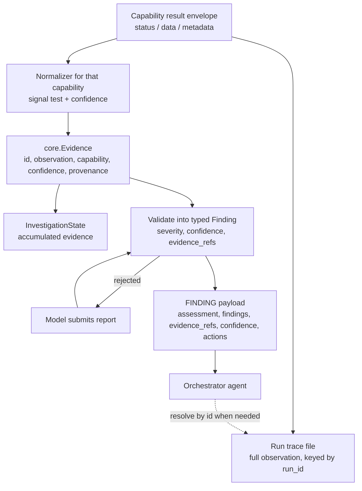

# Static Specialist FINDING Contract - Plan

## Goal Capsule

- **Objective:** An orchestrator agent can decide the next investigation step from what the Static specialist returns, without its context being flooded by raw tool output, and can pull the full observation behind any claim when it needs one.
- **Means:** Emit the design document's FINDING payload — assessment, typed findings, evidence references, confidence, recommended actions — backed by normalized evidence in the shared investigation state, with raw observations resolvable through the run trace (KTD2).
- **Authority:** The design document's context-management constraints outrank this plan. This plan outranks implementer preference. Where a requirement and a technical decision disagree, the requirement wins on behavior and the decision wins on mechanism.
- **Stop conditions:** Stop and ask when bounding the return value would require dropping information the design document requires the orchestrator to receive, or when a change would alter the inter-agent message contract beyond the FINDING payload.

---

## Product Contract

### Summary

The Static specialist returns a concise assessment plus evidence references instead of raw capability output. Evidence is normalized from all eleven static capabilities into the existing `mira/core/evidence.py` model, accumulated in `InvestigationState`, and retrievable after the run through the per-run trace. Findings become validated typed values rather than passthrough model JSON.

### Problem Frame

The specialist's consumer is an orchestrator agent, so its return value lands directly in another model's context window. The design document states the governing constraint four times: specialists return concise findings and references, not raw tool output; the Coordinator receives assessments plus evidence references; detailed evidence is retrieved on demand by ID; no raw tool-output flooding of the Coordinator.

The current return value does the opposite. It carries raw capability output twice — once as the results map, once as every non-`None` `ToolResult` in `FinalOutput.evidence`, untruncated. The 2000-character truncation in `mira/reasoning/runtime/context.py` applies only to the specialist's own prompt, never to what it returns. A single `extract_strings` or `disassemble_function` call on a real binary produces megabytes.

The intended outputs are already built and unwired. `mira/core/evidence.py` carries the design's Evidence Store fields exactly; `InvestigationState.get_evidence_by_id()` is the retrieval path. Both have no non-test importers. `Finding`, `Severity`, and `Confidence` in `mira/reasoning/contracts/finding.py` are never constructed — the loop passes raw model JSON into a field annotated `List[Finding]`, and dataclasses do not validate, so the annotation is false.

### Requirements

**Evidence production**

- R1. Every static capability that can yield a security-relevant signal produces normalized evidence from its result.
- R2. Each evidence item carries a stable identifier, a one-sentence observation, its producing capability, and a confidence value.
- R3. Evidence derived from a paginated capability states that it reflects only the returned page, so absence is never reported as proof of absence.
- R4. A capability result that is not `status: ok` produces no evidence.

**Finding typing**

- R5. Findings in the specialist's return value are typed values whose severity and confidence are validated against their enums.
- R6. Each finding references the evidence supporting it by identifier.
- R7. A finding that fails validation is rejected and returned to the model for correction rather than surfaced to the orchestrator.
- R8. The model is asked for severity, confidence, evidence references, and recommended actions when it submits its report.

**Orchestrator-facing message**

- R9. The specialist's return value carries the artifact identifier, a concise assessment, typed findings, evidence references, an overall confidence, and recommended next actions.
- R10. The return value contains no raw capability output.
- R11. The serialized return value stays within a bounded size regardless of how large the underlying capability output was.

**Retrieval and accumulation**

- R12. The full observation behind any evidence reference is retrievable after the investigation returns.
- R13. Evidence produced during an investigation accumulates in the shared investigation state.

### Key Decisions

- **Plan the specialist side only; defer the orchestrator agent** (session-settled: user-approved — chosen over building both ends: the contract must exist before a consumer can be built against it, at the cost of proving consumability by budget test rather than a live orchestrator run). Governs R9, R10, R11.
- **Defer adapter reasoning memory** (session-settled: user-approved — chosen over bundling it with this work: both rewrite the model-to-state boundary, and doing them together would collide). Governs R5, R8.

### Success Criteria

- A reader given only the return value, with no access to raw capability output, can name a defensible next investigation step.
- The return value remains small enough to sit in an orchestrator's context alongside the findings of prior specialist runs.

### Scope Boundaries

- The orchestrator agent itself. `StaticCoordinator` keeps its current two-branch rule; replacing it is separate work.
- Hypothesis generation. `mira/core/hypothesis.py` stays unwired — hypotheses are meaningful once an orchestrator arbitrates across specialists.
- The `ARTIFACT`, `REQUEST_SPECIALIST`, and `STATUS` inter-agent messages. Each needs a second specialist or a long-running capability to be worth defining.

#### Deferred to Follow-Up Work

- Adapter message history and system prompt — the largest lever on investigation quality; sequence it directly after this work.
- Evaluation corpus and metrics, specified in `plan/init.md` and `plan/PLAN_MCP_SERVER.md` and never built. Until it exists, investigation quality is unmeasured.
- Real MCP transport. `build_fastmcp()` in `mira/mcp/servers/static/server.py` exists and is uncalled; the server is in-process today.
- Two loop defects unrelated to this boundary: `max_tool_calls` is checked only between turns so a multi-call turn overshoots it, and `record_non_empty_response()` fires before report validation so a repeatedly malformed report never trips the degraded exit.
- `_apply_platform_limits` in `mira/mcp/isolation.py` silently no-ops on Windows, so CPU and memory caps are unenforced on the development platform. Security-relevant; own task.

### Sources

- The project design document, `multi_agent_malware_investigation_design.docx` (v1, 29 August 2026), sections 2, 9, 10, 11, 13 and Appendix A. Held outside the repository; section 10 defines the FINDING payload this plan implements.
- `plan/PLAN_MCP_SERVER.md` — the result envelope and error codes the normalizers read.
- `plan/mira_static_agent_harness_idea_plan.md` — the concept plan this work supersedes on the output side.

---

## Planning Contract

### Key Technical Decisions

- KTD1. **Mint evidence identifiers sequentially per investigation** (`E1`, `E2`, …) in the specialist, not in the loop. The specialist already wraps the executor and sees every result in order, so it is the one place with both the result and a stable counter. Governs R2.
- KTD2. **Retrieve raw observations through the existing per-run trace file rather than a new persistence layer** (session-settled: user-approved — chosen over adding persistence to the Evidence Store: `mira/reasoning/runtime/trace.py` already writes every full tool result to disk, so a resolver over it satisfies retrieval with no new storage). Governs R12.
- KTD3. **Compute confidence in the normalizer from signal strength, not from the model** (session-settled: user-approved — chosen over letting the model self-report: evidence confidence describes the strength of an observation, and a model asked to score its own inputs has no independent basis). Governs R2. Finding-level confidence stays the model's, per R5.
- KTD4. **Thread one `run_id` from the specialist through `State` and `Tracer`.** Two exist today and disagree: `_run_id()` in `mira/agents/static/agent.py` names the trace file, while `State.run_id` uses `hash()` — randomized per process — for the metadata. KTD2's provenance resolves through the trace filename, so it cannot work until these are the same value. Governs R12.
- KTD5. **Replace `Evidence.observation_index: int` with `evidence_id: str`.** The index points into `State.observations`, but `State` is local to `AgentLoop._run()` and is discarded on return, so the reference outlives the list it indexes. Governs R6.
- KTD6. **Prove boundedness with a budget test rather than enforcing it in the contract type** (session-settled: user-approved — chosen over structural truncation: a type that silently truncates hides the loss, while a failing test names it). Governs R11.
- KTD7. **Tighten the `submit_report` schema at the adapter.** Today `findings` is optional and `severity`/`confidence` are free-form strings with no enum and no per-item required list, so the model is never asked for the fields the contract needs. Governs R8.
- KTD8. **Write normalizers for all eleven capabilities in this work** (session-settled: user-approved — chosen over widening incrementally from the current two: an orchestrator reasoning over two evidence kinds out of eleven capabilities sees an arbitrary slice of what the specialist actually found).

### High-Level Technical Design

The change is a data-flow change at the specialist's output boundary. Capability results stop flowing outward and instead pass through normalization into evidence; only identifiers and prose cross the boundary.

The dashed edge is the only path by which raw output reaches the orchestrator, and it is pull-based. Nothing on the solid path from `FIND` to `ORCH` carries capability output.

### Assumptions

- The orchestrator will read `observation` prose rather than parse a closed evidence taxonomy. This follows from the orchestrator being a model rather than a routing table, but no orchestrator exists yet to confirm it. If a later orchestrator needs machine-matchable kinds, the normalizers are where that vocabulary would be added.

### Sequencing

U1 first — KTD2 and U3 depend on a single `run_id`. U2 and U4 are independent of each other and can proceed in parallel after U1. U5 depends on both. U6 depends on U2. U7 is last, because it asserts the whole boundary.

---

## Implementation Units

### U1. Unify the run identifier

- **Goal:** One `run_id` per investigation, stable across processes, shared by the trace filename and the run metadata.
- **Requirements:** R12
- **Dependencies:** none
- **Files:** `mira/reasoning/contracts/state.py`, `mira/agents/static/agent.py`, `mira/reasoning/main.py`, `tests/test_state.py`
- **Approach:**
  1. Accept `run_id` as a constructor argument on `State` and delete the `hash()` expression.
  2. Pass the value `_run_id(artifact_id, objective)` already computes in `mira/agents/static/agent.py` into both the tracer and the state.
  3. Derive an equivalent identifier in `mira/reasoning/main.py` for the CLI path, which has no `InvestigationObjective`.
- **Patterns to follow:** `_run_id()` in `mira/agents/static/agent.py` already slugifies the objective name for filename safety; reuse it rather than inventing a second scheme.
- **Test scenarios:**
  - The same artifact and objective produce the same `run_id` across two separate processes.
  - `metadata["run_id"]` in the returned output equals the basename of the trace file written for that run.
  - Two different objectives against one artifact produce different `run_id` values and do not overwrite each other's traces.
- **Verification:** A completed run's metadata identifier names a trace file that exists on disk.

### U2. Evidence normalizers for the eleven static capabilities

- **Goal:** Turn each capability result into zero or more `core.Evidence` items with observations an orchestrator can read.
- **Requirements:** R1, R2, R3, R4
- **Dependencies:** U1
- **Files:** `mira/agents/static/evidence.py` (new), `mira/agents/static/agent.py`, `tests/test_static_evidence.py` (new)
- **Approach:**
  1. Add one pure function per capability, taking the envelope's `data` dict and returning a list of evidence records.
  2. Replace `_evidence_from_result` in `mira/agents/static/agent.py` with dispatch into that table, minting identifiers per KTD1.
  3. Return no evidence for any envelope whose `status` is not `ok`; `data` is `None` in that case.
  4. Keep every threshold a named module constant — these are tuning knobs, not literals.
  5. For the six paginated capabilities, phrase observations as findings within the returned page.
- **Signals per capability:**

  | Capability | Evidence when |
  |---|---|
  | `analyze_pe` | section entropy at or above the packing threshold; unusual section names |
  | `detect_packer` | `packed` is true, or `indicators` is non-empty |
  | `list_imports` | imports matching the anti-debug, injection, crypto, or network sets |
  | `list_exports` | ordinal-only exports; exports present where the header indicates a non-DLL |
  | `extract_strings` | URLs, IP literals, registry paths |
  | `calculate_entropy` | whole-region entropy at or above the threshold |
  | `scan_yara` | each rule match, one evidence item per rule |
  | `run_capa` | each rule finding, one evidence item per rule |
  | `list_functions` | anomalous function count relative to file size |
  | `disassemble_function` | anti-analysis instruction patterns |
  | `file_info` | declared type inconsistent with extension |

- **Patterns to follow:** the existing entropy and packer branches of `_evidence_from_result` establish the shape; `mira/capabilities/static/common.py` defines the envelope the normalizers read.
- **Test scenarios:**
  - Each capability, given a result containing its signal, produces evidence naming that signal in the observation.
  - Each capability, given a clean result, produces no evidence.
  - Each capability, given an `error` and an `unsupported` envelope, produces no evidence and does not raise.
  - A `scan_yara` result with three rule matches produces three evidence items with distinct identifiers.
  - Evidence from a paginated capability states that it covers only the returned page.
  - Confidence values fall within the range the evidence model clamps to, without relying on the clamp.
- **Verification:** A run over a packed sample produces evidence from more than one capability, each with a readable observation.

### U3. Resolve an evidence reference back to its full observation

- **Goal:** Given an evidence record, return the complete capability result it was derived from, after the run has ended.
- **Requirements:** R12
- **Dependencies:** U1
- **Files:** `mira/reasoning/runtime/trace.py`, `tests/test_trace_resolution.py` (new)
- **Approach:**
  1. Record provenance on each evidence item as the run identifier plus the observation's position.
  2. Add a resolver that reads the trace file for a run identifier and returns the full observation at that position.
  3. Return a clear absence rather than raising when the trace file is missing — a caller asking about an old run should get a negative answer, not an exception.
- **Patterns to follow:** `Tracer.save()` already owns the trace path construction; the resolver should derive the same path rather than duplicating the format string.
- **Test scenarios:**
  - Evidence produced during a run resolves to the observation that produced it.
  - Resolution works after the loop has returned and `State` is out of scope.
  - An unknown run identifier resolves to an explicit absence.
  - A truncated or malformed trace file resolves to an explicit absence rather than raising.
- **Verification:** For each evidence item in a completed run, the resolver returns a result whose capability matches the evidence's capability.

### U4. Validate findings into typed values

- **Goal:** Reject model findings that cannot be typed, and construct real `Finding` objects from those that can.
- **Requirements:** R5, R6, R7, R8
- **Dependencies:** U1
- **Files:** `mira/reasoning/runtime/loop.py`, `mira/reasoning/contracts/finding.py`, `mira/reasoning/model/adapter.py`, `tests/test_loop.py`
- **Approach:**
  1. Change `Evidence` to carry `evidence_id: str` per KTD5.
  2. In `_parse_report`, coerce each finding's severity and confidence through their enums, require title and description, and resolve evidence references against the identifiers minted in U2.
  3. Return a validation message on any failure; the existing `_record_report_failure` path feeds it back for the model to retry.
  4. Extend the `submit_report` schema per KTD7: enumerate severity and confidence values, require the per-finding fields, and add evidence references and recommended actions.
- **Patterns to follow:** `_parse_report` already returns a `(result, failure_reason)` pair and the loop already recovers from it — extend that mechanism rather than raising.
- **Test scenarios:**
  - A report with a valid finding produces a `Finding` whose severity and confidence are enum instances.
  - A report with an unrecognized severity is rejected, and the rejection reaches the model as an observation.
  - A report whose finding references an unknown evidence identifier is rejected.
  - A report with a finding missing its title is rejected.
  - A model that submits a malformed report and then a valid one completes with `completion_reason` of `reported`.
  - The declared `submit_report` schema names both severity and confidence as constrained values.
- **Verification:** No raw dictionary survives into the returned findings; every element is a `Finding`.

### U5. Replace the orchestrator-facing message

- **Goal:** The specialist returns the design document's FINDING payload and nothing else.
- **Requirements:** R9, R10
- **Dependencies:** U2, U4
- **Files:** `mira/agents/base.py`, `mira/reasoning/contracts/output.py`, `mira/reasoning/runtime/loop.py`, `mira/agents/static/agent.py`, `tests/contracts/test_agent_integration.py`
- **Approach:**
  1. Change `FinalOutput.evidence` from `List[ToolResult]` to a list of evidence identifiers, making its existing comment true.
  2. Reshape `InvestigationFinding` to the design's FINDING fields: artifact identifier, assessment, findings, evidence references, confidence, recommended actions.
  3. Drop the raw results map and the objective — the orchestrator assigned the objective and already holds it.
  4. Keep the full result set reachable for the CLI path, which is not context-bound.
- **Patterns to follow:** the design document's section 10 message table is the field list; do not add fields beyond it in this unit.
- **Test scenarios:**
  - The returned message carries every field the design's FINDING payload names.
  - The returned message exposes no capability output.
  - A run whose model submits no report still returns a well-formed message with an inconclusive assessment.
  - The CLI path still prints a per-capability summary after the message narrows.
- **Verification:** The returned message serializes without containing any value present in a raw capability result.

### U6. Accumulate evidence in the shared investigation state

- **Goal:** Evidence produced by the specialist reaches `InvestigationState`, giving the designed hub its first inbound edge.
- **Requirements:** R13
- **Dependencies:** U2
- **Files:** `mira/agents/static/agent.py`, `tests/test_investigation_state.py`
- **Approach:**
  1. Accept an optional `InvestigationState` on `investigate()`.
  2. Call `add_evidence()` for each evidence item as it is minted.
  3. Leave the behavior unchanged when no state is supplied, so the CLI path is unaffected.
- **Patterns to follow:** `InvestigationState.add_evidence()` already logs the change into its history; do not add parallel logging.
- **Test scenarios:**
  - A run given a state deposits one evidence record per item minted.
  - Each deposited record is retrievable by `get_evidence_by_id()`.
  - Two sequential runs against one state accumulate rather than replace.
  - A run given no state completes unchanged.
- **Verification:** After two objectives against one artifact, the state holds evidence attributed to both.

### U7. Bound the return value and assert the boundary

- **Goal:** A test that fails if raw output ever returns to the orchestrator-facing message.
- **Requirements:** R10, R11
- **Dependencies:** U5, U6
- **Files:** `tests/test_agent_e2e.py`
- **Approach:**
  1. Script a run that calls the two highest-volume capabilities, `extract_strings` and `disassemble_function`.
  2. Assert the serialized message stays under a fixed budget. Start at 8 KB and tune once against a real sample.
  3. Assert no value in the serialized message appears verbatim in any raw result from the run.
  4. Assert every evidence reference resolves, and every severity and confidence is an enum instance.
- **Execution note:** Write the budget assertion before U5's narrowing lands, so it is observed failing against the current unbounded message.
- **Patterns to follow:** `tests/test_agent_e2e.py` already runs everything below the model for real — artifact store, MCP server, isolated worker. Keep that shape; script only the model.
- **Test scenarios:**
  - A run over high-volume capabilities produces a message under the budget.
  - No raw capability output appears in the serialized message.
  - Every evidence reference in the message resolves through the state.
  - Every finding's severity and confidence are enum instances, not strings.
- **Verification:** Reverting any part of U5 makes this test fail.

---

## Verification Contract

| Gate | Command | Applies to |
|---|---|---|
| Full suite | `pytest tests/` | All units; this is what CI runs |
| Unit under work | `pytest tests/test_static_evidence.py` | U2 |
| Loop validation | `pytest tests/test_loop.py` | U4 |
| Boundary assertion | `pytest tests/test_agent_e2e.py` | U5, U7 |
| Manual, real sample | `python -m mira.reasoning.main <sample> --objective "Assess packing and capability" --trace-dir runs` | U7 and the Objective |

The manual run is the acceptance bar for the Goal Capsule's Objective. Compare the serialized message size before and after, and confirm a reader with only the message can name a next step. The byte budget in U7 is the proxy; this is the judgment it stands in for.

CI runs `pytest tests/` on Python 3.11 after initializing the rules submodules. `test_artifacts.py` at the repository root is a print-driven script and is not collected.

---

## Definition of Done

**Global**

- `pytest tests/` passes.
- No capability output reaches the orchestrator-facing message.
- Every evidence reference in a returned message resolves to its full observation.
- Findings are typed values; `Severity` and `Confidence` are constructed rather than dead.
- Evidence from all eleven capabilities is reachable — no capability silently produces nothing because its normalizer was skipped.
- Abandoned approaches are removed rather than left in the diff.

**Per unit**

| Unit | Done when |
|---|---|
| U1 | One identifier names both the trace file and the run metadata, stable across processes |
| U2 | Each of the eleven capabilities has a normalizer and tests for signal, clean, and error results |
| U3 | An evidence reference resolves to its full observation after the run has returned |
| U4 | An untypeable finding is rejected and the model gets the rejection as an observation |
| U5 | The returned message matches the design's FINDING field list and carries no raw output |
| U6 | Evidence accumulates in `InvestigationState` across successive objectives |
| U7 | The budget and no-raw-output assertions pass, and fail when U5 is reverted |
