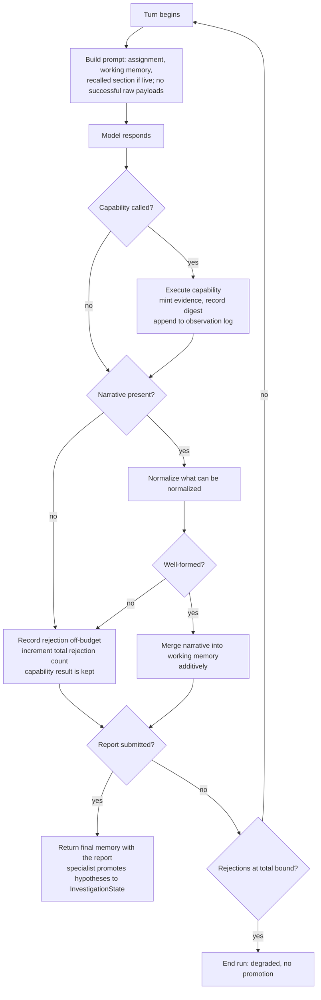
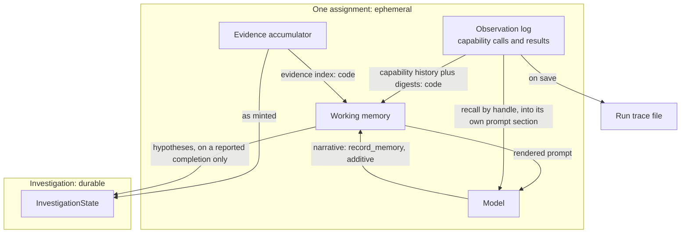

# Static Agent Working Memory - Plan

## Goal Capsule

- **Objective:** A static investigation reads as one line of reasoning rather than a series of unrelated tool calls. What the specialist does next follows from what it already found, and the assessment it hands back names the hypotheses it weighed and the questions it could not close. An analyst can check this from the returned assessment and the run trace without knowing how the loop works.
- **Means:** Give the reasoning loop a per-assignment working memory — code-owned facts plus a model-authored narrative — and render that in place of the raw turn-by-turn tool history (KTD2, KTD3).
- **Authority:** The Key Decisions below outrank implementer preference. Where a requirement and a technical decision disagree, the requirement wins on behavior and the decision wins on mechanism. The FINDING contract in `docs/plans/2026-09-14-1337-feat-specialist-finding-contract-plan.md` outranks this plan on what crosses the specialist boundary.
- **Stop conditions:** Stop and ask when a change would alter what the FINDING payload carries to an orchestrator, when the U3 probe shows the deployment cannot carry a capability call and a narrative in one response, or when honoring the promotion boundary would require writing to `InvestigationState` before the assignment completes.

---

## Product Contract

### Summary

The Static Agent's reasoning loop gains a working memory for the span of one assignment. Code derives the facts — the evidence index, a bounded digest of each result, and the capability history — from what the run already recorded. The model authors the narrative — current understanding, hypotheses, open questions, candidate next investigations — on each turn, and it is required. The prompt stops carrying raw per-call output and carries the working memory instead, with an on-demand path back to any full observation. Hypotheses reach the shared `InvestigationState` when the assignment completes.

### Problem Frame

`render_state()` in `mira/reasoning/runtime/context.py` rebuilds the prompt every turn as a linear transcript: every prior call, every truncated result, the whole evidence list, the findings so far. Nothing in it says what the specialist currently believes, what it ruled out, or what it still needs. The model re-derives its interpretation from raw output each turn, and nothing carries between turns except the transcript. This is the `Tool → Result → Tool → Result` shape that `plan/phase_2_static_agent_working_memory.md` section 16 sets out to replace.

The prior work anticipated this. The specialist-FINDING plan deferred "adapter message history and system prompt" as "the largest lever on investigation quality; sequence it directly after this work," and deferred adapter reasoning memory because both changes rewrite the same model-to-state boundary. That boundary work is this plan.

Two pieces are already built and unwired. `mira/core/hypothesis.py` models belief revision — `support()` and `contradict()` move a hypothesis between provisional states — and has no non-test importer. `State.scratch` exists, is commented "visible to model, excluded from output", and is referenced nowhere.

One property of the runtime shapes everything below: `ModelAdapter.generate()` sends exactly one message per turn, rebuilt from `render_state()`. There is no assistant or tool message history. Anything the model is to see must be rendered into that string; a `ToolResult` that is not rendered is unreachable.

### Key Decisions

- **Working memory is ephemeral execution state for one assignment; `InvestigationState` is durable investigation state** (session-settled: user-directed — chosen over a specialist memory spanning multiple assigned objectives: an assignment is the unit the Coordinator hands out, so it is the unit whose reasoning context has a defined start and end). Governs R1, R16.
- **Code owns the facts; the model owns the narrative** (session-settled: user-directed — chosen over deriving hypotheses in code and over a separate reflection call: interpretation is what the model is for, a mechanically-derived fact needs no model, and a second call per turn doubles cost for content the model can emit on the turn it already takes). Governs R2, R3.
- **The narrative is mandatory, enforced like a submitted report** (session-settled: user-directed — chosen over best-effort carry-forward: memory that silently lags what the model just learned is worse than a turn that has to be retried). Governs R8, R9, R11.
- **Capability history informs, never blocks** (session-settled: user-directed — chosen over refusing a duplicate call: the harness informs and the model decides everywhere else in this system, and a legitimate re-call such as the next page of a paginated capability is indistinguishable from a wasteful one without guessing intent). Governs R5.
- **Raw per-call output leaves the prompt and is retrievable on demand** (session-settled: user-directed — chosen over keeping it alongside the curated memory: carrying both preserves the redundancy this work exists to remove, and a recall path bounds the loss). Governs R12, R14, R15, R19.
- **A capability result survives a rejected narrative** (session-settled: user-directed — chosen over invalidating the whole turn: a capability call can be slow or costly, its result is already valid, and re-running it to correct a formatting mistake wastes real work). Governs R10.
- **Hypotheses promote at completion only** (session-settled: user-directed — chosen over keeping them ephemeral until an orchestrator exists: the promotion path is small, and an orchestrator built later should find real data rather than an empty list). Governs R16, R17.

### Requirements

**Decided turn policy and bounds**

- A response may carry capability calls, `record_memory`, and `submit_report` together. The loop executes the capability calls, validates or records the narrative outcome, then validates and returns the report.
- A valid final report completes the run even when its accompanying narrative is absent or rejected; record that rejection but do not retry after a valid report.
- A recall-only turn does not require `record_memory` and does not enter the narrative-rejection bound.
- A recalled observation is rendered in exactly the one subsequent prompt after the recall turn; the recall turn itself does not count as a prompt containing that payload.
- A successful-result digest is capped at 4,000 serialized characters and ends with an explicit truncation marker when capped.

**Working memory contents**

- R1. Working memory covers one assignment: created when the reasoning run starts, discarded when it returns.
- R2. Its facts derive from what the run already recorded — the evidence accumulator and the observation log — rather than from a parallel copy.
- R3. Its narrative carries the current understanding, the hypotheses, the open questions, and the candidate next investigations.
- R4. Each hypothesis carries its statement, its supporting evidence, its contradicting evidence, a confidence on the same scale `mira/core/hypothesis.py` uses, and a disposition drawn from that module's provisional statuses.
- R5. It names every capability call already made this assignment with its arguments, its outcome, and a handle that resolves to the full result.
- R6. Evidence appears as references carrying why each one matters, never as a copy of the capability output behind it.
- R20. Each successful capability call carries a bounded, code-derived digest of its result, so a call that produced no evidence still leaves something the model can reason from.

**Narrative authoring and enforcement**

- R7. The model supplies the narrative on the same turn as its capability call, not through a separate request. The narrative it writes on a turn therefore reflects results through the previous turn — it is composed before that turn's own call returns.
- R8. A missing or malformed narrative is rejected with a reason the model can act on, and the model is asked again.
- R9. A well-formed narrative with empty collections is accepted and means "nothing changed this turn" — the requirement is shape, not content.
- R21. Narrative updates are additive: an entry the model does not mention stands unchanged, a mentioned entry is revised, and removing one requires closing it by identifier.
- R10. A capability result and the evidence minted from it persist whether or not that turn's narrative was accepted, and a rejected narrative never re-runs a capability.
- R11. A model that never supplies an acceptable narrative terminates the run on a bound that counts every rejection in the run, not only consecutive ones.
- R23. Recording a narrative rejection or a recall does not consume the capability-call budget.

**Model-facing context**

- R12. The prompt carries the working memory in place of the per-call transcript of successful capability output.
- R13. A failed capability call stays visible in the prompt with its error, so the model does not blindly retry a broken call.
- R14. The model is told that the full history remains available, and how to ask for it.
- R15. A recalled observation is bounded in size before it enters the prompt.
- R19. A recalled observation is rendered into the prompt in its own named section, and stays there for a defined number of turns before it is dropped.

**Promotion to shared state**

- R16. Hypotheses reach the shared investigation state when the assignment completes with a submitted report, and not before.
- R17. Promoted hypotheses carry their evidence references and their disposition, so the shared state's records stay resolvable and distinguish a weakened belief from an untested one.
- R18. A run given no shared state completes unchanged.
- R22. The assessment the specialist returns carries the final understanding, the hypotheses it weighed, and the questions it could not close.

### Success Criteria

- In the criterion below, "stops growing" means it does not grow with the volume of each successful result. The prompt may grow by the bounded capability-history and evidence projections for a call, and by the number of open hypotheses and questions; measure that bounded slope against the baseline in the Verification Contract.
- A turn's prompt stops growing with each successful capability result. Its size tracks the number of open hypotheses and questions, not the volume of tool output, measured against the baseline in the Verification Contract.
- Reading a run trace, the capability chosen on turn N traces to a hypothesis or open question the narrative recorded on turn N-1.
- The returned assessment names at least one hypothesis the run weakened or rejected, not only the ones it confirmed.

### Scope Boundaries

The working-memory runtime remains specialist-generic. Dynamic and Forensics inherit its behavior and receive regression coverage for their specialist-neutral context construction; designing their own specialist memory content remains out of scope.

- The Coordinator. `StaticCoordinator` keeps its two-branch rule. Nothing reads promoted hypotheses yet; R16 exists so the orchestrator built later finds real data.
- Memory spanning assignments. A second objective handed to the same specialist starts with a fresh working memory. Only evidence and promoted hypotheses carry across, through the shared state.
- Context compaction. Dropping raw output is the whole of this plan's context work. Summarizing or evicting the narrative as it grows is separate work.
- The Dynamic and Forensics specialists. The mechanism lands in the specialist-agnostic layer so they inherit it, but neither is built here.
- Long-term persistence, and retrieval beyond the handle lookup in R5.

#### Deferred to Follow-Up Work

- `max_tool_calls` is checked only between turns, so a multi-call turn overshoots it. Adjacent to this plan's loop changes but independent of them.
- An evaluation corpus. Until one exists, "investigation quality improved" stays unmeasured and the Success Criteria above are structural proxies.

### Sources

- `plan/phase_2_static_agent_working_memory.md` — the sketch this plan implements. Section 1 sets the working-memory / shared-state boundary, section 15 lists the acceptance bars, section 16 states the target shape.
- `docs/plans/2026-09-14-1337-feat-specialist-finding-contract-plan.md` — deferred this work as "adapter message history and system prompt", and defines the FINDING contract this plan must not disturb.
- `plan/mira_static_agent_harness_idea_plan.md` — the harness concept. Its "Static Agent Context" section is the same boundary at lower resolution.
- `mira/reasoning/runtime/context.py` — `render_state()` is the function this plan replaces.
- `mira/reasoning/runtime/trace.py` — `trace_provenance()` and `resolve_observation()` are the existing handle and lookup this plan reuses.
- `mira/core/hypothesis.py` — `support()` and `contradict()` already model belief revision.

---

## Planning Contract

### Key Technical Decisions

**KTD4 clarification.** A response may contain `tool_calls`, `memory_update`, and `report` together; this supersedes the phrase "`tool_calls` XOR `report`" in KTD4. `AgentLoop` processes capabilities and the narrative before it validates and returns the report, so no sibling call is discarded.

- KTD1. **The working memory is a typed contract in `mira/reasoning/contracts/`, not in `mira/agents/static/`.** The `mira/reasoning/` layer is specialist-agnostic by construction — `composition.py` states that nothing in it knows which specialist is being built — and understanding, hypotheses, and open questions are investigative concepts with no static-analysis content. Static-specific evidence production stays in `mira/agents/static/evidence.py`. Governs R1, R3.
- KTD2. **`State` holds the working memory rather than being replaced by it.** `State` already owns the objective, the run id, the evidence accumulator, and the observation log, which are R2's fact sources. A parallel object would either duplicate them or reach into `State` for them. The unused `scratch` field is removed in the same change: the working memory is the typed thing it stood in for. Governs R1, R2.
- KTD3. **The narrative rides a `record_memory` pseudo-tool declared beside `submit_report`.** `submit_report` is this codebase's established pattern for structured model output that is not a capability: declared in `declarations()`, intercepted by name, validated, fed back as an observation on failure. A schema-enforced tool call gives the narrative per-field typing; parsing prose out of `message.content` gives none and has no precedent here. Instantiates the Key Decision governing R2 and R3. Governs R7.
- KTD4. **`ModelResponse` gains a `memory_update` field that coexists with both `tool_calls` and `report`.** Its current invariant forbids `tool_calls` and `report` together. The narrative is a third channel, not a third alternative, because R7 requires it on the same turn as a capability call. The invariant narrows to `tool_calls` XOR `report`. Governs R7.
- KTD5. **The recall handle is the full provenance string `trace_provenance()` already produces — run id, capability, and occurrence.** That function returns `run_id#capability#occurrence` and `resolve_observation()` refuses anything that does not split into three parts, so a shortened `capability#occurrence` handle would not parse under the existing contract. Using the full string makes R5's handle and an evidence item's provenance the same value, with no second identifier scheme to keep in sync. Governs R5, R14.
- KTD6. **Recall serves from the in-memory observation log, and the filter-and-index logic is factored out of `resolve_observation()` so both paths share it.** `Tracer.save()` runs only in `AgentLoop.run()`'s `finally` block, so the trace file does not exist while the run is in progress — a mid-run recall that reads it returns nothing every time. The live log holds the same capability observations. The trace stays the post-run and cross-process path it already is. Governs R14, R15.
- KTD7. **`record_memory` and `recall_observation` are intercepted above `ToolRuntime`, never registered in it.** `ToolRuntime` is the capability transport: it refuses any name outside `available_tools`, and its executor is the MCP boundary. `submit_report` already bypasses it. Keeping harness tools out of it means the objective's capability allowlist keeps meaning exactly what it means now. Governs R7, R14.
- KTD8. **The narrative validator coerces before it rejects, and the rejection bound counts every rejection in the run.** Two changes to the naive design, each with a reason. A model with a systematic formatting habit fails identically every turn, so a consecutive-rejection bound would end every run inside two of the default ten turns with the capability work already paid for; normalizing what can be normalized — case, whitespace, nearest enum member — costs one degraded field instead of the run. A consecutive counter also never trips for a model that alternates reject and accept, which R11 forbids, so the bound is a total across the run. `CompletionChecker.record_non_empty_response()` currently runs before report validation, which would reset the counter that bounds it; that ordering defect is fixed here. Both thresholds are named constants beside the existing empty-response tolerance. Governs R8, R11.
- KTD9. **Hypotheses are promoted in the specialist, by constructing `core.Hypothesis` from the final narrative at the point the run returns.** The specialist already holds the shared state and deposits evidence into it, so promotion needs no new seam. Evidence keeps depositing as it is minted: it is durable from the moment it exists, and the working memory only references it. The completion-only boundary therefore applies to hypotheses, not to evidence. Governs R16, R17, R18.
- KTD10. **A recalled observation is rendered into its own prompt section with a defined lifetime.** The runtime has no message history — the whole prompt is rebuilt from `render_state()` each turn — so a recall returned only as a `ToolResult` would be dropped by the same rule that drops successful payloads, and the model would receive an identical prompt after asking. A dedicated section, capped by `truncate` and held for a named number of turns before it ages out, is what makes the recall reachable at all. Governs R19.
- KTD11. **Narrative updates are additive, with explicit closes.** Wholesale replacement plus R9's empty-collection acceptance would let a turn that mentions no hypotheses silently erase every belief the run accumulated — the accepted path producing the exact loss the mandatory narrative exists to prevent. The model states new and revised entries and closes an entry by identifier; silence means unchanged. Governs R9, R21.
- KTD12. **Harness-tool observations record through a path that does not touch `tool_call_count`.** `State.record_tool_call()` unconditionally increments the counter `CompletionChecker` compares against `max_tool_calls`, and it is the only way anything enters `state.observations`. Recording a rejection or a recall through it would spend capability budget on harness bookkeeping. A separate recording path keeps both in the trace and out of the budget, and keeps them out of the capability-history projection. Governs R23.
- KTD13. **The working-memory hypothesis mirrors `core.Hypothesis`'s types, not `finding.py`'s.** `core.Hypothesis` carries `confidence` as a float clamped to 0..1 and `contradicting_evidence` as its weakening-reference field, while `Confidence` in `finding.py` is a three-member enum. Only one can make KTD9's promotion a direct construction. The float wins because it is the durable side; the declared schema asks for a bounded number rather than an enum. Governs R4, R17.
- KTD14. **One evidence-minting executor wrapper serves both the specialist and the CLI composition root.** The minting closure lives inside `StaticAgent.investigate`, so `mira/reasoning/main.py` — which calls `loop.run()` with no evidence accumulator — produces none. Once successful payloads leave the prompt, that path renders a working memory with no facts in it, and it is the path the manual acceptance gate runs. Extracting the wrapper so both roots share it is what makes that gate meaningful. Governs R2, R12.

**KTD10 clarification.** A recall is live for exactly one subsequent prompt; it is not rendered in the recall turn. Its payload remains capped by the existing recalled-observation cap.

### High-Level Technical Design

The per-turn flow. Two branches carry the weight: a rejected narrative keeps the capability result, and a submitted report is honored even when the narrative alongside it was rejected.

What reads and writes the memory, and the two different deposit timings into durable state.

### Assumptions

- The deployment behind `mira/reasoning/model/adapter.py` will carry a capability call and a `record_memory` call in one response often enough to be workable. U3's probe measures this against the live deployment before the rest of the plan is built on it, because every unit test drives a scripted double that complies by construction and would otherwise hide a non-compliant model until all units were done.
- Coercion plus a total-rejection bound is enough to keep a formatting-imperfect model productive. The thresholds are named constants for that reason.

### Risks & Dependencies

- **The same-turn narrative is the load-bearing bet and it is not requirement-preserving to reverse.** R7 mandates the same turn and KTD4's invariant change is justified by it, so moving the narrative to the following turn rewrites the Product Contract along with U3, U4, and U8 — it is a re-plan, not a fallback. U3's probe exists so that decision is taken on measured behavior before the dependent units are built, not after.
- Dropping raw output moves investigation quality onto narrative quality. Nothing measures that until an evaluation corpus exists, so the Success Criteria are structural proxies.
- Nothing forces the model to use `recall_observation` when its memory falls short. A run that never calls it still passes every gate while having lost the output it needed, so the manual gate counts invocations.

### System-Wide Impact

The change rewrites the prompt every specialist will receive, in the specialist-agnostic layer. Dynamic and Forensics inherit whatever shape lands here, so the narrative fields must stay free of static-analysis vocabulary (KTD1). It also gives `InvestigationState` its second inbound edge after evidence, which is the first write to `mira/core/hypothesis.py` in the system's history.

### Sequencing

U1 first — every other unit reads the contract it defines. U2 and U3 are independent of each other and can proceed in parallel after U1; U3 carries the probe that gates the same-turn bet, so run it early. U4 needs U3's channel to validate. U5 needs U2's index. U6 needs U1, U2, and U5. U7 needs U1. U9 is independent and must land before the manual acceptance gate is meaningful. U8 is last: it asserts the boundary the earlier units create, and it touches the shared test double that every other unit's tests run through.

---

## Implementation Units

### U1. Working-memory contract

- **Goal:** A typed per-assignment working memory that `State` owns, carrying the narrative and the derived-fact projections.
- **Requirements:** R1, R3, R4, R6
- **Dependencies:** none
- **Files:** `mira/reasoning/contracts/memory.py` (new), `mira/reasoning/contracts/state.py`, `tests/test_working_memory.py` (new), `tests/test_state.py`
- **Approach:**
  1. Define the working-memory type and its narrative parts: understanding, hypotheses, open questions, candidate next investigations. Give each hypothesis and each open question a stable identifier, since R21 closes entries by identifier.
  2. Give each hypothesis the fields R4 names, typed per KTD13 — confidence as a float clamped to 0..1, weakening references named `contradicting_evidence`, and a disposition using `mira/core/hypothesis.py`'s provisional statuses.
  3. Hold the memory on `State`, constructed with the run, per KTD2.
  4. Remove the unused `scratch` field. `State.snapshot()` currently emits it, so the snapshot's shape changes with it.
  5. Include the memory in `State.snapshot()` so each turn's trace records it as it stood.
- **Patterns to follow:** `mira/reasoning/contracts/finding.py` for frozen dataclass contracts. Take field names and the confidence scale from `mira/core/hypothesis.py`, not from `finding.py`'s enum — KTD13 owns that choice and U7's promotion depends on it.
- **Test scenarios:**
  - A new `State` carries an empty working memory whose collections are empty rather than absent.
  - A hypothesis records supporting and contradicting evidence references separately.
  - A hypothesis confidence outside 0..1 is clamped, matching `core.Hypothesis`.
  - A hypothesis disposition accepts each provisional status `mira/core/hypothesis.py` defines and rejects an unknown one.
  - `State.snapshot()` includes the memory and no longer includes `scratch`.
  - Merging a narrative leaves the evidence accumulator and the observation log untouched.
- **Verification:** `State` exposes the memory, no module references `scratch`, and a snapshot survives `json.dump` with the tracer's `default=` serializer.

### U2. Shared observation index

- **Goal:** One helper that projects the observation log into capability history and resolves a handle to a full observation, used by both the live and the trace path.
- **Requirements:** R2, R5, R20
- **Dependencies:** U1
- **Files:** `mira/reasoning/runtime/trace.py`, `mira/reasoning/contracts/state.py`, `tests/test_trace_resolution.py`, `tests/test_state.py`
- **Approach:**
  1. Factor the filter-and-index logic out of `resolve_observation()` — select one capability's own calls in order, return the one at a position — into a helper both callers share. The helper takes a normalized sequence of call-and-result pairs: the trace path holds turn records with parallel lists, the live path a flat list of contract objects, so neither shape can be the helper's interface.
  2. Add the live projection: for each capability call in the observation log, its name, arguments, outcome, and its full `trace_provenance()` handle per KTD5.
  3. Exclude harness-tool entries from the projection. `_record_report_failure` already writes `submit_report` entries into `state.observations`, and U4 and U5 add more; none is a capability and none may take an occurrence number.
  4. Add the per-result digest R20 requires — a bounded, code-derived summary of a successful result, computed without the model.
  5. Leave `resolve_observation()`'s signature and its None-on-any-miss contract alone; it keeps serving the post-run path.
- **Patterns to follow:** `resolve_observation()` already establishes per-capability occurrence counting, and its docstring explains why a run-wide counter drifts. Do not introduce a second counting rule.
- **Test scenarios:**
  - Two calls to one capability produce handles at occurrence 0 and 1; a call to a different capability starts its own numbering at 0.
  - A failed call appears in the history with its error and still occupies an occurrence.
  - A harness-tool entry in the observation log occupies no occurrence and does not appear in the capability history.
  - A handle resolves to the observation whose call name and arguments match it.
  - An out-of-range occurrence resolves to an explicit absence rather than raising.
  - The live projection and `resolve_observation()` name the same observation for the same handle in one run.
  - A successful result that mints no evidence still carries a digest, and the digest stays within its cap for a very large result.
- **Verification:** `tests/test_trace_resolution.py` passes against the refactored `resolve_observation()` unchanged, and a handle taken from the live projection parses under it.

### U3. Narrative channel

- **Goal:** The model can submit a narrative as a declared tool call on the same turn as a capability call, and it reaches the loop.
- **Requirements:** R7
- **Dependencies:** U1
- **Files:** `mira/reasoning/model/adapter.py`, `mira/reasoning/contracts/model.py`, `tests/test_adapter_declarations.py`, `tests/test_model_adapter.py`
- **Approach:**
  1. Declare `record_memory` in `declarations()` beside `submit_report`, with per-field schema for understanding, hypotheses, open questions, and candidates. Declare hypothesis confidence as a bounded number per KTD13, and carry the disposition as a constrained value.
  2. Add `memory_update` to `ModelResponse` and narrow the mutual-exclusion invariant to `tool_calls` XOR `report`, per KTD4.
  3. In `generate()`, split a `record_memory` call out of `message.tool_calls` into `memory_update` and leave the rest as capability calls. Do not early-return the way `submit_report` does: one turn can carry both.
  4. Stop the `submit_report` branch from discarding sibling calls. It currently returns the moment it sees the report, dropping any capability call in the same message; `record_memory` makes multi-call turns the norm, so that latent drop becomes routine.
  5. Declare `record_memory` independently of the objective's allowlist, as `submit_report` already is.
- **Execution note:** Before the dependent units are built, run a throwaway probe against the live deployment — declare `record_memory` alongside one capability, drive a handful of turns, and record how often a single response carries both. The same-turn design is the plan's load-bearing bet and is not reversible without re-planning (see Risks), so this unit is not done until that rate is measured and recorded.
- **Patterns to follow:** the `submit_report` entry in `declarations()` for the enum-constrained, per-item-required schema shape. `tool_parameters()`'s `BOUND_FIELDS` exclusion for fields the runtime supplies rather than the model.
- **Test scenarios:**
  - A response carrying only a `record_memory` call yields a memory update and no capability calls.
  - A response carrying a capability call plus `record_memory` yields both, and the capability call is not swallowed.
  - A response carrying `submit_report` plus `record_memory` yields both the report and the memory update.
  - A response carrying `submit_report` plus a capability call preserves the capability call.
  - Constructing a `ModelResponse` with both `tool_calls` and `report` still raises; one with `tool_calls` and `memory_update` does not.
  - `record_memory` appears in the declared tools even when the objective permits a single capability.
  - The declared schema names hypothesis confidence as a bounded number and disposition as a constrained value.
- **Verification:** A scripted response with two tool calls produces one capability call and one memory update, with nothing dropped; the probe's measured same-turn rate is recorded.

**U3 completion clarification.** Replace the test that expects `ModelResponse(tool_calls=..., report=...)` to raise with one that proves the loop executes the calls and processes `memory_update` before it returns the valid report.

### U4. Narrative validation and the rejection bound

- **Goal:** A well-formed narrative merges into the memory; a malformed one goes back to the model without discarding the turn's capability result or its report; a model that never complies still terminates.
- **Requirements:** R8, R9, R10, R11, R21, R23
- **Dependencies:** U3
- **Files:** `mira/reasoning/runtime/loop.py`, `mira/reasoning/runtime/completion.py`, `mira/reasoning/contracts/state.py`, `mira/reasoning/main.py`, `tests/test_loop.py`, `tests/test_completion.py`
- **Approach:**
  1. Normalize before validating, per KTD8: case, whitespace, and nearest-member coercion on constrained fields. Reject only what cannot be coerced.
  2. Validate the coerced update against U3's `record_memory` schema, whose types come from U1, returning a value-and-failure-reason pair.
  3. Merge additively per KTD11 — unmentioned entries stand, mentioned entries are revised, closing an entry requires naming its identifier.
  4. Order the turn so the capability executes and its evidence is minted before validation runs, per R10 — a validation failure must not unwind it.
  5. Honor a submitted report on a turn whose narrative was rejected. The report is the run's product and is independently validated; losing it to a formatting mistake would discard the whole investigation.
  6. Record the rejection through the off-budget path KTD12 adds to `State`, and feed it back as an observation mirroring `_record_report_failure`.
  7. Count total rejections across the run, trip the degraded exit at a named threshold, and fix the `record_non_empty_response()` ordering so a rejected turn does not reset the counter bounding it.
  8. Add a `memory_rejected` event kind and a branch for it in `_print_turn`, so a rejection is visible in the CLI instead of printing nothing.
- **Patterns to follow:** `_parse_report` and `_record_report_failure` in `mira/reasoning/runtime/loop.py` are the whole shape — validate, return a reason, record it as a failed `ToolResult`, let the model recover. `_enum_member`'s failure message names the offending value and the valid set; match that specificity. `_evidence_refs`' escape hatch is the precedent for not deadlocking a model in endless rejection.
- **Test scenarios:**
  - A well-formed narrative merges into the working memory and the turn proceeds.
  - A narrative whose disposition differs only in case or surrounding whitespace is coerced and accepted, not rejected.
  - A narrative missing a required field is rejected, and the reason reaches the model as a failed observation naming the field.
  - A turn whose capability succeeded and whose narrative was rejected keeps the capability result and its evidence.
  - A turn carrying a valid report and a malformed narrative completes as `reported`.
  - A rejected narrative does not re-execute the capability: an executor counting invocations sees one call across the rejection and the turn after it.
  - A narrative mentioning one hypothesis leaves the other hypotheses in memory untouched.
  - A narrative closing a hypothesis by identifier removes it; closing an unknown identifier is rejected.
  - A narrative with empty collections is accepted and changes nothing.
  - A model alternating rejected and accepted narratives still terminates on the total bound.
  - Rejections do not increment `tool_call_count`.
- **Verification:** A scripted run that flubs one narrative and then supplies a valid one completes as `reported`, with the first turn's evidence present in the result and the capability-call count unchanged by the rejection.

### U5. Recall

- **Goal:** The model can pull the full observation behind any handle in the capability history, and actually receives it.
- **Requirements:** R14, R15, R19, R23
- **Dependencies:** U2
- **Files:** `mira/reasoning/model/adapter.py`, `mira/reasoning/runtime/loop.py`, `mira/reasoning/contracts/state.py`, `tests/test_loop.py`
- **Approach:**
  1. Declare `recall_observation` alongside `record_memory`, taking a handle in the form U2's projection renders.
  2. Intercept it in the loop, above `ToolRuntime` per KTD7, and resolve it through U2's index against the live log.
  3. Hold the recalled payload on `State` for the named number of turns KTD10 defines, capped with the existing `truncate`, so U6 can render it. Returning it only as a `ToolResult` would leave it unreachable.
  4. Return an explicit not-found result for an unknown handle rather than an empty success.
  5. Record the recall through KTD12's off-budget path.
- **Patterns to follow:** `truncate` and `MAX_OBSERVATION_CHARS` in `mira/reasoning/runtime/context.py` are the existing cap and keep their job here. `ToolRuntime.execute`'s "failures are observable results, never exceptions" posture applies to the not-found case.
- **Test scenarios:**
  - Recalling a handle from the capability history places that call's full result in the recalled slot.
  - The recalled payload survives into the next turn's prompt and ages out after its defined lifetime.
  - A recalled result longer than the cap is truncated, with the truncation stated.
  - An unknown handle, and a well-formed handle with an out-of-range occurrence, each return a failed result naming what was not found.
  - `recall_observation` never reaches the tool executor: an executor that raises on any call is not invoked by a recall.
  - A recall does not increment `tool_call_count`, and does not appear as a capability in the history.
- **Verification:** After the prompt has stopped carrying a payload, a recall puts that payload back into the next prompt within its cap.

**U5 completion clarification.** U5 follows U3 as well as U2. Its expiry test must prove that a recall made on turn N is absent from turn N, present only in turn N+1, and absent again from turn N+2.

### U6. Rewrite the model-facing prompt

- **Goal:** The prompt carries the working memory instead of the successful-output transcript, keeps failures visible, renders a live recall, and tells the model how to ask for one.
- **Requirements:** R12, R13, R14, R19, R20, R22
- **Dependencies:** U1, U2, U5
- **Files:** `mira/reasoning/runtime/context.py`, `mira/reasoning/definition/instructions.py`, `tests/test_context.py`
- **Approach:**
  1. Replace `render_state()`'s per-call transcript with the working-memory rendering: assignment, current understanding, hypotheses with their evidence and disposition, the evidence index, capability history with handles and digests, open questions, candidate next investigations.
  2. Render the live recalled observation in its own named section per R19, so it survives the successful-payload drop.
  3. Keep failed calls and their errors per R13; drop successful raw payloads.
  4. Add the instruction sections the new obligations need: that a narrative is required every turn and is additive, that the full history is reachable by handle through `recall_observation`, and that the final report's summary should carry the understanding, weighed hypotheses, and unclosed questions R22 requires.
  5. Keep the existing "cite these identifiers" evidence framing — the FINDING contract still rejects a finding citing unknown evidence.
- **Patterns to follow:** `assemble_instructions()`'s flat section list in `mira/reasoning/definition/instructions.py`. Add sections there rather than embedding instructions in the state rendering.
- **Execution note:** Three tests in `tests/test_context.py` assert the behavior being removed — raw output, raw errors, and truncation in the prompt. Rewrite them to assert the curated shape. The raw-error one survives, narrowed to failures only.
- **Test scenarios:**
  - A successful capability result's payload does not appear in the prompt.
  - A failed capability call's error does appear.
  - A successful call that minted no evidence still contributes a digest and a handle.
  - A live recalled observation appears in its own section and is gone after its lifetime expires.
  - The prompt names every handle in the capability history.
  - Evidence identifiers still appear with their observations.
  - The prompt states that a narrative is required and additive, and names the recall tool.
  - A run with no tools called yet renders an empty memory without claiming facts it does not have.
- **Verification:** Recording a 10,000-character successful result leaves the prompt within a few hundred characters of its prior size, while that call's digest and handle are both present.

### U7. Promote hypotheses at completion

- **Goal:** Hypotheses reach `InvestigationState` when the assignment completes with a report, and not before.
- **Requirements:** R16, R17, R18, R22
- **Dependencies:** U1
- **Files:** `mira/agents/static/agent.py`, `mira/reasoning/contracts/output.py`, `tests/test_investigation_state.py`, `tests/test_static_investigation_loop.py`
- **Approach:**
  1. Carry the final working memory out of the loop on `FinalOutput`, so the specialist can read it.
  2. In `investigate()`, construct a `core.Hypothesis` per final hypothesis and deposit it with `add_hypothesis()` after the loop returns. Mint identifiers continuing past what the shared state already holds, as evidence identifiers already do. Types match directly per KTD13, so no confidence conversion is involved.
  3. Carry the disposition onto the promoted record per R17, so a weakened belief is distinguishable from an untested one.
  4. Promote only when the run completed with a submitted report per R16. A degraded run's memory predates the results of its rejected turns, so its beliefs would land stale beside durable evidence.
  5. Compose the returned assessment to carry the understanding, weighed hypotheses, and unclosed questions R22 requires, without adding a field to the FINDING payload.
  6. Leave the no-state path unchanged per R18, matching the existing `state is not None` guard.
- **Patterns to follow:** the evidence deposit in `investigate()` is the model to copy — mint, then `state.add_evidence()`, which logs its own history entry. `add_hypothesis()` does the same; do not add parallel logging.
- **Test scenarios:**
  - A reported run given a state deposits one hypothesis per hypothesis in the final memory.
  - Each deposited hypothesis is retrievable by `get_hypothesis_by_id()` and carries its evidence references and disposition.
  - Nothing is deposited mid-run: a state inspected after the first capability call holds evidence but no hypotheses.
  - A run that ends degraded deposits its evidence and no hypotheses.
  - A run given no state completes unchanged.
  - Two sequential assignments against one state accumulate hypotheses rather than replacing them.
  - The returned assessment names the weighed hypotheses and the unclosed questions.
- **Verification:** After one reported assignment the shared state holds hypotheses whose evidence references all resolve through `get_evidence_by_id()`, and at least one carries a non-default disposition.

### U9. Evidence parity on the CLI path

- **Goal:** The CLI composition root mints evidence the same way the specialist does, so the manual acceptance gate exercises a populated working memory.
- **Requirements:** R2, R12
- **Dependencies:** none
- **Files:** `mira/agents/static/agent.py`, `mira/agents/static/wiring.py`, `mira/reasoning/main.py`, `tests/test_static_wiring.py`
- **Approach:**
  1. Extract the evidence-minting executor wrapper from the closure inside `StaticAgent.investigate` — the one that normalizes each result, mints identifiers, and attaches provenance — into a reusable factory, per KTD14.
  2. Have `StaticAgent.investigate` use the extracted factory, so there is one implementation rather than two.
  3. Use it in `mira/reasoning/main.py` and pass the accumulator into `loop.run()`, which currently receives none.
  4. Keep the CLI's no-shared-state behavior: it mints and renders evidence, and promotes nothing.
- **Patterns to follow:** the `execute` closure in `mira/agents/static/agent.py` is the code being extracted; preserve its per-capability occurrence counting and its read-`results`-before-writing ordering, both of which existing normalizers depend on.
- **Test scenarios:**
  - A CLI run over a sample accumulates evidence with sequential identifiers.
  - Evidence minted on the CLI path carries the same provenance shape as the specialist path, and resolves through the trace after the run.
  - The specialist path's evidence output is unchanged by the extraction.
  - A CLI run deposits nothing into any shared state.
- **Verification:** The manual acceptance run's prompt carries a non-empty evidence index.

### U8. Prove the boundary end to end

- **Goal:** A test that fails if raw successful output returns to the prompt, or if the memory stops carrying between turns.
- **Requirements:** R12, R14, R16, R21
- **Dependencies:** U4, U6, U7, U9
- **Files:** `tests/support.py`, `tests/test_agent_e2e.py`, `tests/contracts/test_agent_integration.py`
- **Approach:**
  1. Give the shared `ToolThenReportModel` a valid default narrative on every turn, so existing callers keep working without rewriting each one.
  2. Add a second double that omits or malforms its narrative, so the rejection path is covered by something other than the compliant case.
  3. Script a run over the two highest-volume capabilities, `extract_strings` and `disassemble_function`.
  4. Assert no value from a successful raw result appears in any turn's prompt, reading the prompts back from the trace.
  5. Assert a hypothesis recorded on an early turn is still present in a later turn's prompt after intervening turns that do not mention it.
  6. Assert the hypotheses promoted into the shared state match the final memory and carry dispositions.
- **Patterns to follow:** `tests/test_agent_e2e.py` already runs everything below the model for real — artifact store, MCP server, isolated worker — and scripts only the model. Keep that shape. Extend `ToolThenReportModel` rather than forking a second compliant double.
- **Test scenarios:**
  - A run over high-volume capabilities produces prompts containing no verbatim successful payload.
  - A hypothesis stated on turn 1 appears in the turn-3 prompt without being restated on turn 2.
  - The `context_sent` recorded in the trace does not grow in proportion to result size across turns.
  - Evidence references in the returned FINDING still resolve through the trace.
  - The shared state's hypotheses after the run match the final working memory.
  - A run whose model never supplies a valid narrative terminates on the total bound rather than exhausting its turns.
- **Verification:** Reverting U6 makes the no-raw-payload assertion fail; reverting U4's merge makes the memory-continuity assertion fail.

---

**U8 scope-regression clarification.** Extend the existing specialist-neutral context test to instantiate Dynamic- and Forensics-shaped roles and assert that the generic memory rendering carries no static-analysis vocabulary; this is regression coverage for inherited runtime behavior, not implementation of either specialist's memory design.

## Verification Contract

| Gate | Command | Applies to |
|---|---|---|
| Full suite | `pytest tests/` | all units; this is what CI runs |
| Memory contract | `pytest tests/test_working_memory.py tests/test_state.py` | U1 |
| Observation index | `pytest tests/test_trace_resolution.py` | U2 |
| Adapter channel | `pytest tests/test_adapter_declarations.py tests/test_model_adapter.py` | U3 |
| Loop validation and bound | `pytest tests/test_loop.py tests/test_completion.py` | U4, U5 |
| Prompt shape | `pytest tests/test_context.py` | U6 |
| Promotion | `pytest tests/test_investigation_state.py tests/test_static_investigation_loop.py` | U7 |
| CLI evidence parity | `pytest tests/test_static_wiring.py` | U9 |
| Boundary assertion | `pytest tests/test_agent_e2e.py tests/contracts/test_agent_integration.py` | U8 |
| Manual, real sample | `python -m mira.reasoning.main <sample> --objective "Assess packing and capability" --trace-dir runs` | U6, U9, and the Goal Capsule Objective |

**Baseline first.** Before U6 lands, run the manual command once on the current code and record the last turn's `prompt_tokens` from the run metadata, plus the number of capability calls it took. That pair is the baseline the first Success Criterion is measured against; without it the prompt-size claim has no number behind it. Note that `MAX_OBSERVATION_CHARS` already caps each rendered result at 2000 characters, so the existing growth is bounded — the win to demonstrate is the slope across turns, not an unbounded-to-bounded change.

The manual run is the acceptance bar for the Objective. Read the `context_sent` of successive turns in the trace: each should carry the working memory and no successful payload, and the capability chosen on one turn should answer a question or test a hypothesis the previous turn recorded. Record how many times the run invoked `recall_observation`; zero invocations across a multi-turn run means the instruction is not landing, not that the run is clean.

On Windows the suite runs as `.venv/Scripts/python.exe -m pytest -q`. CI runs `pytest tests/` on Python 3.11 after initializing the rules submodules. `test_artifacts.py` at the repository root is a print-driven script and is not collected.

---

## Definition of Done

**Global**

- `pytest tests/` passes.
- No successful capability payload appears in any prompt the run sends, and a recalled payload does.
- A narrative is required, coerced-then-validated, and merged additively on every turn that calls a capability or submits a report.
- A rejected narrative never re-runs a capability, never discards a valid report, and never spends capability budget.
- Hypotheses reach `InvestigationState` on a reported completion and not before; evidence keeps depositing as it is minted.
- The CLI path mints evidence through the same wrapper the specialist uses.
- `State.scratch` is gone and no module references it.
- Abandoned approaches are removed rather than left in the diff.

**Per unit**

| Unit | Done when |
|---|---|
| U1 | `State` carries a typed working memory that survives snapshot serialization, `scratch` is gone, and hypothesis types match `core.Hypothesis` |
| U2 | One helper serves both the live projection and `resolve_observation()`, handles parse under the existing contract, and every successful result carries a digest |
| U3 | A single response carries a capability call and a narrative, both reach the loop, and the live-deployment same-turn rate is measured and recorded |
| U4 | A malformed narrative is coerced where possible, rejected otherwise without losing the capability result or a valid report, and the total-rejection bound ends a non-complying run |
| U5 | A handle returns its full observation into a rendered prompt section, capped, without consuming capability budget |
| U6 | The prompt carries the memory, digests, failures, and any live recall, but no successful payloads |
| U7 | Hypotheses appear in the shared state after a reported run only, with resolvable evidence references and dispositions |
| U9 | A CLI run renders a populated evidence index, and the specialist path is unchanged |
| U8 | The no-raw-payload, memory-continuity, and non-compliant-model assertions pass, and each fails when its unit is reverted |
