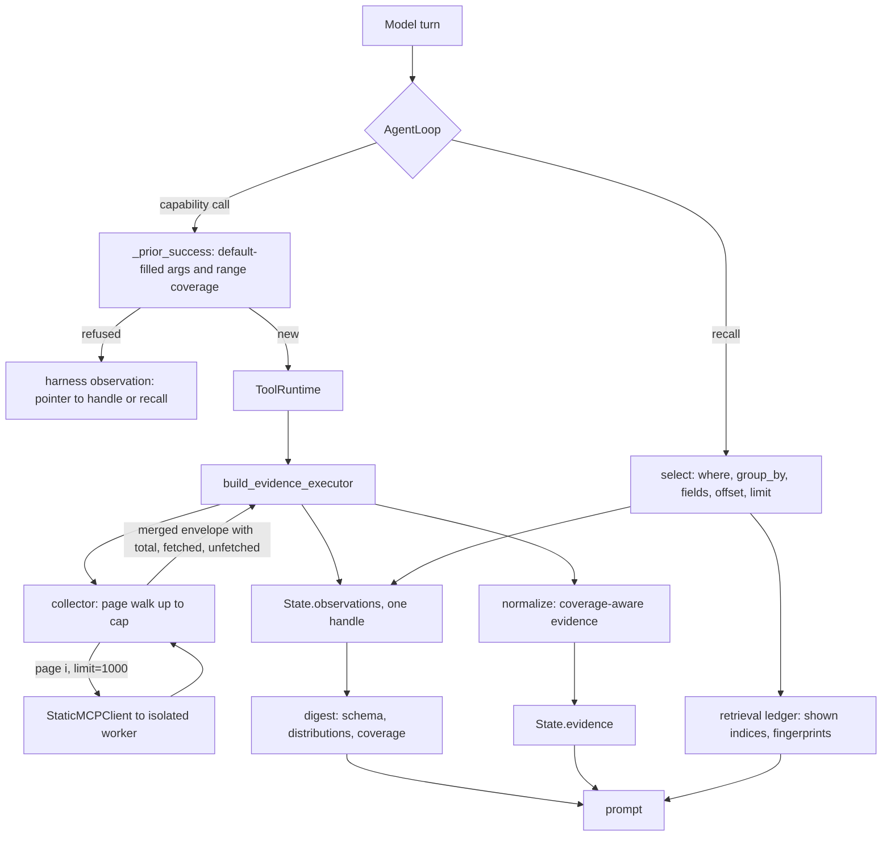
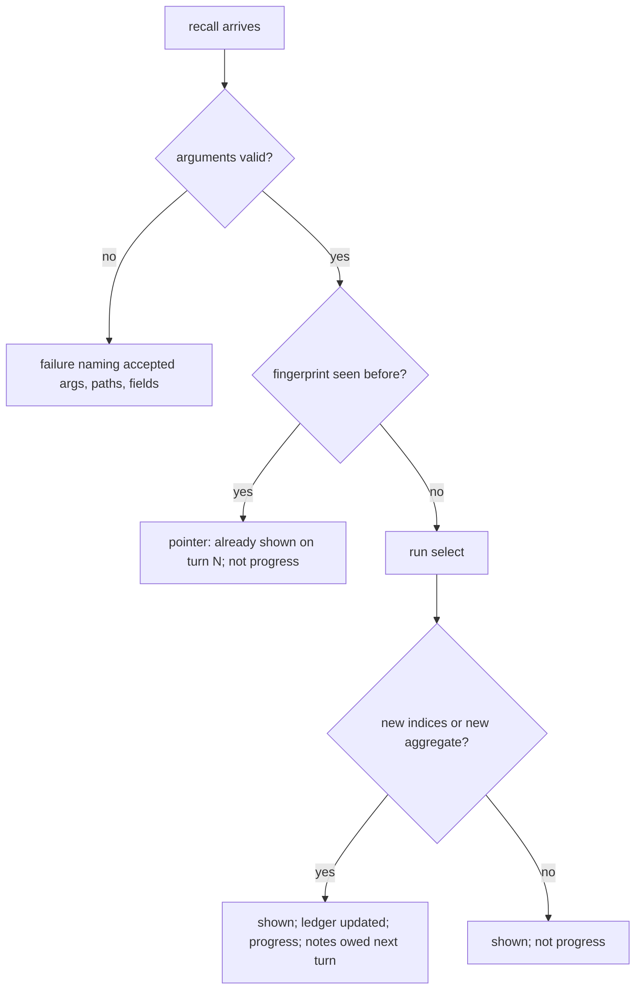
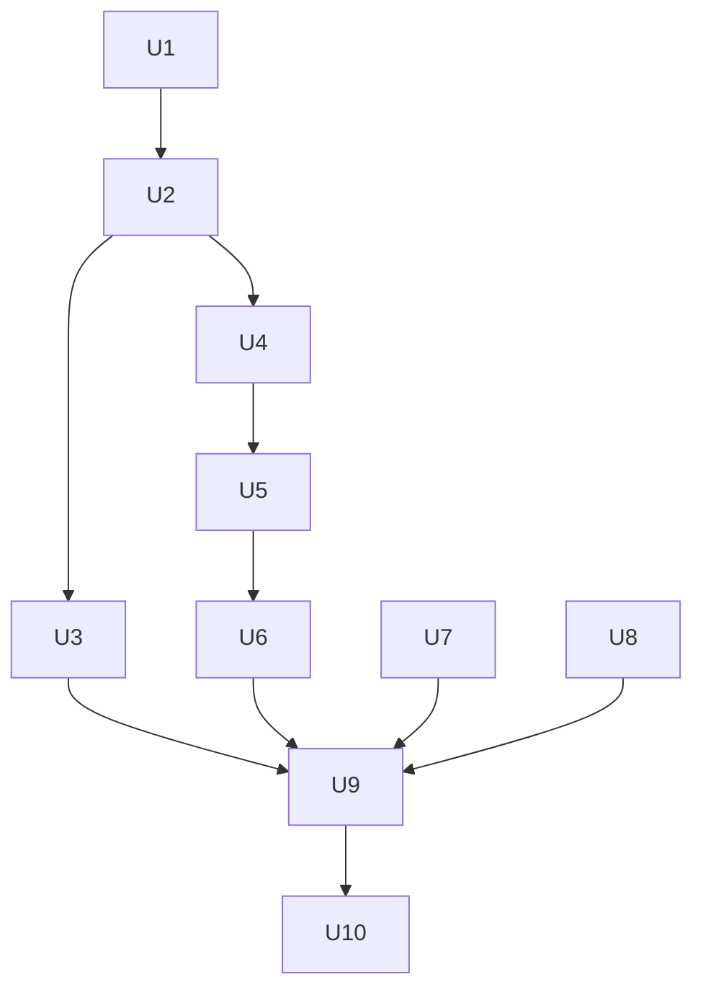

# Static Retrieval Pipeline - Plan

## Goal Capsule

- **Objective:** A static investigation reaches its verdict from every item a list capability reports, up to a stated cap, not only the first page. When it stops short of the full list, it says so. It costs fewer model calls and tokens than today. An analyst can see in the trace and the report what the agent fetched, what it examined, and what it never looked at.
- **Means:** The static specialist collects each list result once and stores it whole (KTD1, KTD2). The prompt carries a schema-and-distribution digest (KTD4). The model pulls exact slices with `recall_observation` queries (KTD5). The harness tracks what it has shown (KTD7, KTD8).
- **Authority:** The Product Contract Key Decisions outrank the KTDs, and the KTDs outrank the unit text. On behavior, the requirement wins; on mechanism, the KTD wins. Two earlier plans keep their authority: `docs/plans/2026-09-15-1200-feat-static-agent-working-memory-plan.md` (working memory, recall, evidence minting) and `docs/plans/2026-09-14-1337-feat-specialist-finding-contract-plan.md` (what crosses the specialist boundary).
- **Stop conditions:**
  - Stop after U9 and present the measured comparison. U10 starts only on the user's decision.
  - Stop and ask if collecting a list would require raising an MCP input contract's page bound (`le=1000`).
  - Stop and ask if a change would alter the FINDING payload in `mira/agents/base.py`.
  - If no baseline can be recorded (no model key or no samples), finish U1–U8 but claim no efficiency or detection change.
- **Execution profile:** Units land one commit each, in dependency order. U1 lands first and records the baseline before any behavior change. U9 needs a live model (`MODEL_API_KEY`) and user-supplied samples.
- **Tail ownership:** `ce-work` implements U1–U8 and the deterministic part of U9. The user runs the live benchmark, owns the labeled sample set, and decides on U10.

---

## Product Contract

### Summary

The static specialist fetches the whole of a paginated list once, up to a per-capability cap, and stores it as one observation. It records total, fetched, and unfetched counts. The prompt shows a generic digest of that list: item count, field schema, value distributions, and coverage. It shows no arbitrary sample items. `recall_observation` gains exact-match filters, group-by counts, and offset/limit paging over the full stored list. The harness records what each recall showed, refuses repeats, and does not count them as progress. `list_imports` is the first vertical slice, and it is measured against a baseline before the design extends to the other list capabilities.

### Problem Frame

A static run sees only the page a capability returned. `paginate()` in `mira/capabilities/static/common.py` returns at most `limit` items (default 100) plus `has_more`, with no total. `recall_observation` can only read that stored page (`live_observation` in `mira/reasoning/runtime/trace.py`). An import or string past item 100 is therefore invisible to both the evidence normalizers and the model. The only way to reach it is a fresh call with an `offset`, which the model rarely makes.

The digest the model sees (`digest()` in `mira/reasoning/runtime/payload.py`) samples the first two items and the last item of every large array. Those samples are arbitrary and hide the field names the model needs for a recall. The recall limit (`MAX_RECALL_CHARS = 6000`) already makes the model page through large arrays, and raising it does not scale.

Progress accounting is also loose. A recall is always counted as progress (`AgentLoop._run`, the `record_non_empty_response` branch). So is any notes update, even one that changes nothing. A rerun is refused only when its arguments match exactly (`_prior_success`), so `list_imports()` and `list_imports(offset=0)` both run.

Smaller defects sit in the same paths. One unknown evidence id rejects a whole notes update (`_hypotheses` in `mira/reasoning/runtime/narrative.py`). `calculate_entropy` accepts `chunk_size=1` over a 4 MiB region, which is about 4.2 million chunk records (`mira/capabilities/static/entropy_analyzer.py`). Malware can also defeat import-based reading with a sparse import table, ordinal-only imports, or APIs resolved at run time. The current import normalizer says nothing about any of these.

### Requirements

**Complete observations**

- R1. A collected list capability returns its whole list, up to a per-capability item cap, as one stored observation under one handle.
- R2. Every collected observation records total, fetched, and unfetched counts. When items are unfetched, the digest, recall answers, and evidence observations say so and name how to fetch the rest.
- R3. A failure after the first page keeps the pages already fetched and reports the failure and the unfetched range. A first-page failure is the capability's failure, as today.

**Digests**

- R4. The digest of a large array of objects shows the item count, the field schema, value distributions for low-cardinality fields, distinct and null counts, and coverage. It shows no sampled items.
- R5. Digests stay specialist-agnostic. Semantic interpretation reaches the prompt only as evidence lines with ids.
- R6. A digest stays within `MAX_DIGEST_CHARS` whatever the list size.

**Targeted retrieval**

- R7. `recall_observation` supports `where` exact-match filters, `fields` projection, `group_by` counts, `contains` search, and `offset`/`limit` paging over the full stored list.
- R8. A recall answer names each item by its index within its path. The handle, path, and index address one record for the whole run and in the trace.
- R9. A recall that names an unknown argument, path, or field fails and lists the names that exist.

**Retrieval progress**

- R10. The harness records which item indices of each handle and path a recall has shown, separately from evidence. The capability history shows that coverage.
- R11. An identical repeat recall gets a pointer to the turn that showed it, not its content. A turn whose only activity is repeat recalls and unchanged notes is not progress.
- R12. A capability call is refused with a pointer to the earlier handle in two cases: its default-filled arguments match an earlier successful call, or an earlier collected observation already covers the range it asks for.

**Agent flexibility and detection coverage**

- R13. The model chooses what to retrieve. No heuristic score removes, hides, or reorders stored items. Unclassified items stay counted and reachable.
- R14. Import evidence reports ordinal-only imports and APIs used for run-time resolution, so an obfuscated import table is not read as clean.

**Bounded processing**

- R15. `calculate_entropy` rejects a chunk request over a fixed chunk cap and names the smallest `chunk_size` that fits. Chunk windows at or above the entropy threshold become evidence.

**Correctness**

- R16. Evidence provenance resolves to the collected observation. Evidence observations state their coverage: all fetched items, or a truncated subset.
- R17. A notes update that cites unknown evidence ids keeps its valid parts. The unknown ids are dropped and reported to the model, and this does not count as a rejection.
- R18. Reports still contain only findings that cite minted evidence. A recall item reference is not citable evidence.

**Measurement and rollout**

- R19. A benchmark harness records, per run: model calls, prompt and completion tokens, turns, wall-clock time, capability calls, refused reruns, recalls served and repeated, discarded findings, and coverage. It compares a baseline run set with a pipeline run set.
- R20. Detection results are reported separately from efficiency results, per sample against its label. No detection improvement is claimed without a measured result.
- R21. `list_imports` is the first collected capability. Other list capabilities are collected only after the slice passes its gate (U9).

### Key Decisions

- **Evidence stays code-driven, and recall never mints evidence.** (session-settled: user-directed — chosen over letting the model cite recalled text: every finding must trace to a normalizer rule and its observation.) Governs R16, R18.
- **No heuristic or classifier permanently filters indicators, and the full evidence stays reachable.** (session-settled: user-directed — chosen over triage that keeps only a summary: import-based signals are easy to mislead with decoy imports and obfuscation.) Governs R13, R14.
- **Efficiency is measured before any trained classifier. A classifier is judged only on held-out benign and malicious executables.** (session-settled: user-directed — chosen over adding a model to MIRA now.) Governs R19, R20.
- **`list_imports` is the vertical slice, validated before the design extends.** (session-settled: user-directed — chosen over converting every list capability at once.) Governs R21.
- **Digests stay generic. Meaning comes from the existing analyzers as cited evidence.** (session-settled: user-approved — chosen over specialist-aware digests: the reasoning package stays reusable for the dynamic and forensics specialists.) Governs R5.

### Success Criteria

These numbers come from the U1 baseline and the U9 run, on the same samples and model, with several runs per sample:

- Zero duplicate capability calls served, and zero repeat recalls served with content.
- For each collected list under its cap, fetched equals total.
- No sample's median prompt tokens or model calls go above its baseline median. The actual deltas are reported, not thresholded.
- No malicious sample's majority verdict regresses to benign compared with baseline. Every verdict change is listed with its evidence.

### Scope Boundaries

- Out: a separate orchestration service or pipeline process.
- Out: new runtime dependencies.
- Out: changing MCP input contracts or their `le=1000` page bound.
- Out: large-file handling (overlay detection, installer unpacking, child artifacts). See `context.md`.
- Out: a Coordinator redesign, and the dynamic and forensics agents.
- Out: verdict-rule changes. Report validation keeps its current rules, and R18 is verified, not extended.

#### Deferred to Follow-Up Work

- **Deterministic preflight profile and import-combination triage.** This was proposed earlier in the session; the pasted spec narrowed scope to retrieval. It can be layered on the U2 collector later.
- **Trained PE classifier evaluation.** Gated on U9. Use EMBER-style feature extraction, Yousuf et al. 2023 for feature selection, and Delphi Scanner as the reference for API-sequence modeling. Run offline, with training dependencies kept out of MIRA's runtime. If a classifier wins on held-out data, it enters only as one more cited observation.
- **Digital-signature verification.** Needs a new dependency.
- **Sparse-import-table signal.** Needs a size-relative threshold, calibrated on the labeled set.
- **Verdict-set validation.** A `verdict` enum and the rule that a non-benign verdict needs at least one finding.

### Sources

- [EMBER: An Open Dataset for Training Static PE Malware Machine Learning Models](https://arxiv.org/abs/1804.04637)
- [Yousuf et al., Windows malware detection based on static analysis with multiple features, PeerJ CS 9:e1319 (2023)](https://peerj.com/articles/cs-1319)
- [Delphi Scanner: efficient and interpretable static malware detection via API sequence modeling](https://arxiv.org/pdf/2609.19900)

---

## Planning Contract

### Current Execution Flow (verified)

1. `StaticAgent.investigate` (`mira/agents/static/agent.py`) and the CLI `investigate` (`mira/reasoning/main.py`) build the executor chain: `build_executor` binds the artifact, and `build_evidence_executor` mints `E<n>` evidence through `normalize()`. Both live in `mira/agents/static/wiring.py`.
2. `AgentLoop._run` (`mira/reasoning/runtime/loop.py`) asks the model for a turn. Recalls are intercepted by name. Other calls are checked by `_prior_success` (exact-argument match), then run through `ToolRuntime.execute`, which maps an error envelope to a failed `ToolResult`.
3. `StaticMCPClient.invoke` calls `StaticMCPServer.call`, which validates input and runs one isolated worker per call (`mira/mcp/isolation.py`, spawn context). The worker re-parses the PE each time. The result envelope is `{status, data, metadata}`, and paging counters live in `metadata`.
4. `normalize()` (`mira/agents/static/evidence.py`) reads `data` only and tags paged evidence `within the returned page`.
5. `render_state` (`mira/reasoning/runtime/context.py`) shows each call as `[handle] call`, its evidence ids, and `digest(result.output)`. `capability_history` recomputes each digest every turn.
6. `_recall` uses `select()` against `live_observation`. Answers are shown once, through `State.recalled`.
7. `_parse_report` rejects any finding that cites unminted evidence. `_final_report_turn` salvages the supported part through `_supported_part`.

### Evidence Lifecycle

| Layer | Owner | Where it lives | Citable in a finding | Counts as coverage |
|---|---|---|---|---|
| Raw observation (collected list) | static executor (U2) | `State.observations`, trace file | no | fetched |
| Evidence `E<n>` | `normalize()` | `State.evidence`, `InvestigationState.evidence` | yes | analyzed |
| Retrieval ledger | loop (U6) | `State` | no | shown |
| Notes and hypotheses | model through `record_memory` | `State.working_memory`, then promoted `H<n>` | cite `E<n>` only | n/a |
| Findings | model through `submit_report` | `FinalOutput.findings` | cite `E<n>` only | n/a |

### Capability Execution Matrix

| Capability | Paged | Collected | Unit | Notes |
|---|---|---|---|---|
| `list_imports` | yes | yes, the slice | U2 | Usually one page at `limit=1000`. Cap is KTD3. |
| `list_exports` | yes | after gate | U10 | Cheap, and the PE is re-parsed per page. |
| `extract_strings` | yes | after gate | U10 | Each page rescans the file (at most 4 MiB). Cost decided from U9 data. |
| `scan_yara` | yes | after gate | U10 | `ruleset` is part of the call's identity. |
| `run_capa` | yes | after gate | U10 | About 150s per call on notepad.exe. It must stay a single page, and only `has_more` triggers another. |
| `list_functions` | yes | after gate | U10 | Today it returns only the entry point. |
| `disassemble_function` | yes | after gate | U10 | Identity includes `function_address`. Window capped at 64 KiB. |
| `calculate_entropy` | no | no | U8 | Chunk cap only. |
| `file_info`, `analyze_pe`, `detect_packer` | no | no | none | Already small and fixed-size. |

### Key Technical Decisions

- KTD1. **Collect pages in the static specialist's executor.** Rationale: MCP contracts keep their 1000-item page bound and per-call isolation. The specialist already owns paging semantics (`PAGED_CAPABILITIES`) and evidence minting. The loop stays specialist-agnostic. The collector wraps `client.invoke` in `mira/agents/static/wiring.py`, walks pages at `limit=1000` until `has_more` is false or the cap is reached, and returns one merged envelope that still satisfies the capability's output contract. Pages are fetched one after another. Concurrent fetching after the first page is a later optimization, to add only if U9 shows fetch time matters.
- KTD2. **Coverage rides envelope metadata as a result-contract convention.** `paginate()` adds `total`. A merged envelope carries `offset`, `total`, `fetched`, `unfetched`, `pages`, and `fetch_error` when a later page failed. Generic code (digest, loop) may read these keys because they belong to the shared result envelope (`mira/contracts/results.py`), not to static semantics.
- KTD3. **The item cap is a per-capability constant in `wiring.py`, starting at 10,000 for `list_imports`.** It is a tuning knob, like the thresholds in `evidence.py`, calibrated from U1 and U9 data. Ten pages is the worst case per call.
- KTD4. **The digest is schema plus distributions, computed in `payload.py`.** An array of objects over `SMALL_ARRAY_ITEMS` renders as `path: N items, fields {…}`. Each field gets a distinct count and a null count. Fields with few distinct values also get their top values with counts. Arrays at or below `SMALL_ARRAY_ITEMS` stay whole, because a short PE section list still needs every row. Sample-derived values are shown only for low-cardinality fields and are truncated to `SCALAR_CHARS`.
- KTD5. **The recall query language is `handle`, `path`, `offset`, `limit`, `contains`, `where`, `fields`, `group_by`.** `start`/`count` are renamed `offset`/`limit` to match capability paging. No external consumer depends on the old names. `where` maps a field to a value, or to a list meaning any-of. Fields combine with AND. Strings compare case-insensitively, other types exactly, and a missing key matches `null`. `group_by` returns value counts in descending order, bounded by `MAX_RECALL_CHARS`. Unknown arguments are rejected (R9) instead of ignored as today.
- KTD6. **An item reference is the handle, path, and index. No new id scheme.** The collected observation is immutable for the run and its order is deterministic, so the index is stable. Minting per-item ids would blur retrieval and evidence (see the evidence Key Decision).
- KTD7. **The retrieval ledger lives on the reasoning `State`.** It is keyed by handle and path and holds the shown indices plus each query's fingerprint and turn. `select()` reports which indices it showed, and the loop records them. The ledger is separate from `State.evidence`.
- KTD8. **What counts as progress.** A turn is progress if it has any of:
  - a capability call that ran;
  - a recall that showed new items, or a `group_by` query not asked before;
  - a report;
  - notes that changed the working memory.

  An identical recall gets `already shown on turn N` and does not set `notes_pending`.
- KTD9. **Rerun refusal stays in the generic loop.** `_prior_success` compares arguments after filling defaults from the `ToolSpec` JSON schema. A collected call whose `offset` falls inside an earlier observation's covered range (KTD2 keys), with all other arguments equal, is refused with a pointer to `recall_observation`. Failed calls are never matched, as today.
- KTD10. **Collected capabilities hide `limit` from the model and keep `offset`.** `_capability_specs` strips `limit` and amends the description for collected capabilities. Prompt cost no longer depends on the page size the model picks, and duplicate detection becomes exact.
- KTD11. **Unknown evidence ids in notes are dropped, not fatal.** `apply_narrative` returns a failure and a list of warnings. A warning is logged as a harness observation and does not call `record_memory_rejection`. Structural errors still reject the whole update.
- KTD12. **Entropy rejects an over-cap chunk request.** It does not coarsen silently. `MAX_ENTROPY_CHUNKS` lives in `entropy_analyzer.py`, and the error names `ceil(length / MAX_ENTROPY_CHUNKS)` as the smallest valid `chunk_size`.
- KTD13. **The benchmark is a standalone script over `FinalOutput.metadata`.** New counters on `State` feed it. Samples are listed in a manifest outside the repo. Each sample runs several times, and medians and spread are reported. Samples are never committed.

### High-Level Technical Design

Data flow for one collected call and a later recall:



Recall progress decision:



Illustrative digest. This is directional, not exact output:

```text
data.imports: 412 items, fields {dll, name, ordinal, address}
  dll: 9 distinct — KERNEL32.dll 180, USER32.dll 95, ADVAPI32.dll 40, … (+6)
  name: 409 distinct, 3 null
coverage: fetched 412 of 412 (offset 0)
```

### Alternatives Considered

- **Server-side collection (an `all` mode or a higher page bound in each MCP capability).** Rejected. It changes the external contract, pushes one very large response through the worker queue, and imposes the policy on every caller.
- **Raising recall and digest character limits.** Rejected. Cost grows with list size, and arbitrary lists still overflow (problem stated in the brief).
- **A separate `StaticAnalysisPipeline` service with its own store.** Deferred. The trace already holds full results, and `live_observation` already reads them mid-run. A second store would duplicate both.
- **Minting a citable id per list item.** Rejected under KTD6 and the evidence Key Decision.

### Assumptions

- The pasted spec of 2026-10-11 supersedes the earlier preflight and triage proposal. Those items moved to Deferred to Follow-Up Work.
- The user supplies the benign, malicious, ambiguous, and malformed samples for U9 outside the repo.
- Real import tables rarely exceed 1,000 entries, so the `list_imports` slice is usually one worker call. U1 data confirms or corrects this.

---

## Implementation Units



### U1. Benchmark harness and baseline counters

- **Goal:** Record efficiency, coverage, and detection numbers for the current code before any behavior changes.
- **Requirements:** R19, R20.
- **Dependencies:** none.
- **Files:**
  - `mira/reasoning/contracts/state.py`
  - `mira/reasoning/runtime/loop.py`
  - `scripts/benchmark_static.py` (new)
  - `tests/test_benchmark.py` (new)
  - `tests/test_loop.py`
- **Approach:**
  1. Add counters to `State`: model calls (incremented on every `generate`, including forced-notes and final-report calls, whether or not usage is reported), recalls requested, identical recall fingerprints seen (count only, no behavior change yet), reruns refused, and findings discarded by `_supported_part`.
  2. Add these to `AgentLoop._metadata`. The change is additive, so existing keys stay.
  3. `scripts/benchmark_static.py` reads a manifest of `path, label` rows and runs `mira.reasoning.main.investigate` N times per sample. It records wall-clock time and one JSON row per run. A compare mode prints two separate tables: efficiency (medians and spread for calls, tokens, turns, time) and detection (majority verdict against label, plus completion reasons).
  4. The script has an `if __name__ == "__main__":` guard, because the isolated workers use spawn (see the trap in `TODO.md`).
- **Patterns to follow:** `State.record_usage`, `AgentLoop._metadata`, and `mira/reasoning/main.py` for composing a run.
- **Test scenarios:**
  - A scripted run of two capability calls, one recall, and a report yields `model_calls` 3 and `recalls_requested` 1 in metadata.
  - A forced-notes call counts as a model call even when the model returns no usage.
  - A run whose final report is salvaged records the number of discarded findings.
  - The benchmark's per-run row on the minimal PE with a scripted model contains every metric key and the sample's label.
  - Compare mode on two synthetic row sets reports medians per sample and keeps efficiency and detection in separate tables.
  - A manifest row naming a missing file is reported as a failed row, and the remaining rows still run.
- **Verification:** The full suite passes. A baseline JSON for notepad.exe exists under `runs/benchmarks/`, recorded from this commit. The labeled-set baseline is recorded from this same commit whenever the samples arrive, before the U9 comparison runs.

### U2. Page totals and the collected `list_imports` observation

- **Goal:** One `list_imports` call stores the whole import list with explicit coverage.
- **Requirements:** R1, R2, R3, R21.
- **Dependencies:** U1.
- **Files:**
  - `mira/capabilities/static/common.py`
  - `mira/agents/static/wiring.py`
  - `tests/test_static_capabilities.py`
  - `tests/test_static_wiring.py`
  - `tests/test_adapter_declarations.py`
- **Approach:**
  1. `paginate()` adds `total` to the page metadata (KTD2). All paged capabilities get it.
  2. Add a collected-capability table with item caps in `wiring.py` (KTD3), holding only `list_imports` in this unit.
  3. `build_executor` routes a collected capability through the page walker (KTD1). The walker starts at the model's `offset` and merges `data.imports`, keeping the first page's other metadata.
  4. On a later-page failure, return the merged pages with `fetch_error` and `unfetched` set (R3).
  5. `_capability_specs` hides `limit` for collected capabilities and amends their description (KTD10).
- **Patterns to follow:** The artifact binding in `build_executor`, `ScriptedClient` in `tests/test_trace_resolution.py`, and the error envelope from `result_error`.
- **Test scenarios:**
  - `paginate` over 250 items with `limit=100` reports `total` 250 on every page.
  - A fake client holding 2,345 imports: one `list_imports` call returns 2,345 items, `total` 2,345, `fetched` 2,345, `unfetched` 0, and 3 page calls.
  - A list over the cap stops at the cap, with `unfetched` equal to total minus cap and an `offset` hint for the rest.
  - The model's `offset=500` starts the walk at 500, and the merged metadata says so.
  - Page 2 times out: page 1 is kept, nothing from page 2 onward is merged, `fetch_error` names the timeout, and `unfetched` covers from the failed page's offset.
  - A first-page failure returns the capability's own error envelope unchanged.
  - The merged envelope still validates against `ListImportsOutput`.
  - The declared `list_imports` tool has no `limit` property and still has `offset`. Uncollected capabilities keep `limit`.
  - A model-supplied `artifact_id` is still stripped from a collected call.
- **Verification:** One `list_imports` handle holds the whole list, and the trace records a single tool result for it.

### U3. Coverage-aware import evidence and obfuscation signals

- **Goal:** Import evidence describes the whole fetched list and flags tables that hide intent.
- **Requirements:** R14, R16, R13.
- **Dependencies:** U2.
- **Files:**
  - `mira/agents/static/evidence.py`
  - `tests/test_static_evidence.py`
- **Approach:**
  1. `normalize()` derives a coverage phrase from the envelope metadata (KTD2) and gives it to every paged normalizer in place of `PAGE_CAVEAT`. Every page carries `total` after U2, so uncollected capabilities also get an accurate phrase, such as `within the first 100 of 8214 strings`. The phrase is either `among all N imports`, or `within the first F of T imports fetched` when truncated.
  2. Add a dynamic-resolution vocabulary (`LoadLibrary*`, `GetProcAddress`, `LdrLoadDll`, `LdrGetProcedureAddress`) as a weak-confidence category in `IMPORT_CATEGORIES`.
  3. Add an ordinal-only observation that states the count of imports with no name.
  4. Add no size-relative threshold (see Deferred to Follow-Up Work).
- **Patterns to follow:** `IMPORT_CATEGORIES`, `_examples`, `_fraction_confidence`.
- **Test scenarios:**
  - `VirtualAllocEx` at index 1,500 of a 2,000-import collected result yields process-injection evidence. The page-only behavior of today would miss it.
  - A complete list's observation reads `among all 2000 imports`. A truncated one names fetched and total.
  - Three nameless imports yield one observation naming the count 3.
  - `GetProcAddress` with `LoadLibraryA` yields dynamic-resolution evidence at weak confidence.
  - A clean import list yields no evidence.
  - A failed result still yields nothing and does not raise.
  - Evidence from a collected call carries the call's handle as provenance, and it resolves through `resolve_observation`.
- **Verification:** The paged-caveat tests are updated to the coverage phrase, and no observation claims coverage it does not have.

### U4. Schema and distribution digest

- **Goal:** The prompt shows what a list contains and which fields it has, at fixed cost.
- **Requirements:** R4, R5, R6, R2.
- **Dependencies:** U2.
- **Files:**
  - `mira/reasoning/runtime/payload.py`
  - `tests/test_recall.py`
  - `tests/test_context.py`
- **Approach:**
  1. Replace the two-head, one-tail sampling in `_sketch` for large arrays of objects with the KTD4 summary.
  2. Add a coverage line when the envelope metadata carries KTD2 keys.
  3. Keep `PARTIAL_MARKER` when anything is summarized.
  4. Keep arrays of scalars as a count plus a distinct count.
  5. Add no static vocabulary to `payload.py`.
- **Patterns to follow:** `list_arrays`, `_sketch`, and `truncate`.
- **Test scenarios:**
  - A 412-item import array renders count, the four field names, `dll` top values with counts, and a `name` distinct count with 3 null.
  - A 10,000-item string array's digest stays under `MAX_DIGEST_CHARS` and shows no string value. The high-cardinality field shows only counts.
  - A 5-item section array is still shown whole.
  - A truncated collected result's digest shows `fetched F of T` and the unfetched count.
  - A low-cardinality value longer than `SCALAR_CHARS` is truncated.
  - The digest does not alter the result (existing test kept).
  - The digest of an arbitrary non-PE array uses only that array's own keys and values (specialist-neutral regression, extending `test_the_generic_notes_carry_no_static_vocabulary`).
- **Verification:** `test_a_digest_samples_both_ends_of_an_array` is replaced by a schema test, and the high-volume e2e prompt-growth test still passes.

### U5. Recall query extensions

- **Goal:** The model asks for an exact slice of a stored list without guessing names or paging blindly.
- **Requirements:** R7, R8, R9.
- **Dependencies:** U4.
- **Files:**
  - `mira/reasoning/runtime/payload.py`
  - `mira/reasoning/runtime/loop.py`
  - `mira/reasoning/model/adapter.py`
  - `mira/reasoning/definition/instructions.py`
  - `tests/test_recall.py`
  - `tests/test_adapter_declarations.py`
  - `tests/test_context.py`
- **Approach:**
  1. Extend `_recall_arguments` and `select` with KTD5. Filters apply in this order: `where`, `contains`, then either `group_by` or `offset`/`limit` with `fields`.
  2. `select` also returns the indices it showed, for U6.
  3. Answer headers name the path, the match count, and the continuation `offset`. When the observation is truncated, the header also says which items were never fetched and how to fetch them.
  4. Update `_recall_declaration` and the "Reading past a digest" instructions to the new names, and mention `where` and `group_by`.
- **Patterns to follow:** The existing `select` headers and continuation hints, and the `fields` validation.
- **Test scenarios:**
  - `where {"dll": "advapi32.dll"}` over the 412-item list returns exactly the 40 ADVAPI32 rows, matching case-insensitively.
  - `where {"name": null}` returns the 3 ordinal-only imports.
  - `where {"dll": ["USER32.dll", "GDI32.dll"]}` returns their union.
  - `group_by "dll"` returns 9 values with counts that sum to 412.
  - `group_by` combined with `where` counts only the matched rows.
  - `offset=400, limit=50` returns items 400..411 and says nothing remains.
  - Each returned line starts with its index, and `path=data.imports.37` returns the same record as index 37 of a range.
  - An unknown argument `start` fails and lists the accepted arguments.
  - An unknown `where` or `group_by` field fails and lists the item keys.
  - A `where` on a non-array path fails and names the arrays.
  - A truncated observation's answer says items past `fetched` were never fetched and names the call to fetch them.
  - `group_by` over more distinct values than fit stops within `MAX_RECALL_CHARS` and says how many were left out.
- **Verification:** The declaration, the instructions, and `select` accept the same argument names.

### U6. Retrieval ledger, duplicate handling, and progress

- **Goal:** Repeats cost nothing and do not look like progress, and the model sees what it has not examined.
- **Requirements:** R10, R11, R12, R13.
- **Dependencies:** U5.
- **Files:**
  - `mira/reasoning/contracts/state.py`
  - `mira/reasoning/runtime/loop.py`
  - `mira/reasoning/runtime/trace.py`
  - `mira/reasoning/runtime/context.py`
  - `tests/test_loop.py`
  - `tests/test_recall.py`
  - `tests/test_context.py`
- **Approach:**
  1. Add the ledger to `State` (KTD7).
  2. `_recall` checks the fingerprint (normalized arguments) before `select`. A repeat gets the KTD8 pointer.
  3. `CapabilityRecord` gains a shown-coverage field, and `render_state` prints it under the digest, for example `shown: 0–49, 400–411 (62 of 412)`.
  4. Progress judgement and `notes_pending` follow KTD8. Detect unchanged notes by comparing the memory before and after the merge.
  5. `_prior_success` follows KTD9, using `self.tools.available_tools` for defaults.
- **Patterns to follow:** `record_harness_observation`, `capability_history`, and `CompletionChecker`.
- **Test scenarios:**
  - The same recall twice: the second answer is a pointer naming turn 1 and contains no items.
  - A recall that differs only in argument order or `contains` case counts as the same fingerprint.
  - A model that only repeats one recall with unchanged notes ends `degraded` after two turns, not at `max_turns`.
  - A recall whose items were all shown before, through a different query, is served but is not progress.
  - The history line shows the merged ranges after recalls of 0–49 and 400–411.
  - `list_imports()` after `list_imports(offset=0)` is refused, because the default-filled arguments are equal.
  - `list_imports(offset=300)` after a complete fetch of 412 is refused with a recall pointer naming `offset=300`.
  - `list_imports(offset=10000)` after a fetch truncated at 10,000 runs, because that range is unfetched.
  - A failed earlier call is still retried.
  - A refused repeat recall does not set `notes_pending`, so the next turn owes no notes for it.
  - Evidence ids are unaffected by recalls: the ledger never adds to `State.evidence`.
- **Verification:** The new counters from U1 show zero repeats served in the scripted e2e run.

### U7. Keep valid notes when an evidence id is unknown

- **Goal:** One bad citation no longer throws away a turn's reasoning.
- **Requirements:** R17, R18.
- **Dependencies:** none.
- **Files:**
  - `mira/reasoning/runtime/narrative.py`
  - `mira/reasoning/runtime/loop.py`
  - `tests/test_loop.py`
  - `tests/test_memory_integration.py`
  - `tests/test_working_memory.py`
- **Approach:**
  1. Under KTD11, `_hypotheses` filters unknown ids out of `supporting_evidence` and `contradicting_evidence` and collects warnings.
  2. `apply_narrative` returns the failure and the warnings.
  3. `_merge_narrative` logs warnings as a non-counting harness observation that names the dropped ids and the hypothesis.
  4. Structural errors still reject the whole update.
- **Patterns to follow:** KTD8 coercion in `narrative.py` (the working-memory plan), and `record_harness_observation`.
- **Test scenarios:**
  - A notes update with H1 citing E1 (known) and E99 (unknown) merges H1 with only E1, and the next prompt names E99 as dropped.
  - The same update leaves `memory_rejections` unchanged.
  - A hypothesis whose only citations are unknown is kept with empty support and a warning.
  - A malformed `hypotheses` field still rejects the whole update and counts.
  - The promoted `core.Hypothesis` carries only resolvable evidence ids.
  - A finding citing an unknown id is still rejected at report time (R18 unchanged).
- **Verification:** `test_a_hypothesis_citing_unknown_evidence_is_rejected_whole` is replaced by the keep-valid-parts test.

### U8. Bounded entropy chunks and chunk evidence

- **Goal:** `calculate_entropy` cannot emit unbounded output, and its window results reach the evidence.
- **Requirements:** R15, R16.
- **Dependencies:** none.
- **Files:**
  - `mira/capabilities/static/entropy_analyzer.py`
  - `mira/contracts/capabilities/static/entropy.py`
  - `mira/agents/static/evidence.py`
  - `tests/test_static_capabilities.py`
  - `tests/test_static_evidence.py`
- **Approach:**
  1. Add the KTD12 rejection, and state the cap in the contract's `chunk_size` description.
  2. `_calculate_entropy` reports how many windows are at or above `HIGH_REGION_ENTROPY` and lists up to `MAX_EXAMPLES` window offsets.
- **Patterns to follow:** `result_error(... "INVALID_INPUT" ...)`, `_entropy_confidence`, `_examples`.
- **Test scenarios:**
  - `chunk_size=1` over 4 MiB is `INVALID_INPUT`, and the message names the smallest valid `chunk_size`.
  - A request at exactly the cap succeeds with that many chunks.
  - The existing 65-chunk test still passes.
  - Chunks where 2 of 65 windows are at or above 7.2 yield one observation naming 2 of 65 and their offsets.
  - Chunks all below the threshold, with whole-region entropy below it, yield no evidence.
- **Verification:** No `calculate_entropy` result can hold more than the cap of chunk records.

### U9. Slice gate: deterministic proof and measured comparison

- **Goal:** Prove the `list_imports` slice end to end and measure it against the U1 baseline before extending.
- **Requirements:** R19, R20, R21, R13, R18.
- **Dependencies:** U3, U6, U7, U8.
- **Files:**
  - `tests/test_agent_e2e.py`
  - `tests/test_static_investigation_loop.py`
  - `tests/support.py`
- **Approach:**
  1. Add a scripted-model e2e run over a fake client with 2,000 imports. It calls `list_imports`, recalls with `where` and `group_by`, writes notes, and reports a finding that cites the injection evidence.
  2. Then run the U1 harness live on the same manifest and model as the baseline, with several runs per sample.
  3. Present the results under the Success Criteria, as separate efficiency and detection tables, and stop for the user's decision.
- **Execution note:** The live part needs `MODEL_API_KEY` and the user's samples. Without them, land the deterministic tests and report that the live gate is outstanding.
- **Test scenarios:**
  - The e2e report cites evidence for an import at index 1,500, and that evidence resolves to the collected handle.
  - No prompt in the e2e trace contains a raw import record beyond what a recall returned that turn.
  - Prompt growth across turns stays within the existing high-volume bound.
  - Counters report zero repeat recalls served and zero duplicate calls run.
  - A finding citing a recalled item index instead of an `E` id is rejected.
  - Malformed input (a truncated PE, a non-PE) yields a well-formed FINDING with `inconclusive` or a reported verdict, and no crash.
  - An empty import table yields no import evidence, a digest of `0 items`, and a recall that answers with no items.
- **Verification:**
  - The deterministic tests pass.
  - The live comparison covers notepad.exe, other benign System32 binaries, the user's malicious PEs, ambiguous cases (UPX-packed benign tools, signed installers), and malformed files.
  - The live comparison is presented without claiming any detection change beyond what it measured.

### U10. Extend collection to the other list capabilities

- **Goal:** Apply the proven slice to `list_exports`, `extract_strings`, `scan_yara`, `run_capa`, `list_functions`, and `disassemble_function`.
- **Requirements:** R1, R2, R16, R21.
- **Dependencies:** U9 and the user's go decision.
- **Files:**
  - `mira/agents/static/wiring.py`
  - `mira/agents/static/evidence.py`
  - `tests/test_static_wiring.py`
  - `tests/test_static_evidence.py`
- **Approach:**
  1. Add each capability to the collected table with a cap from U9 data.
  2. Settle the `extract_strings` cost strategy from the U9 measurements (Open Questions).
  3. `run_capa` walks pages only on `has_more` (Capability Execution Matrix).
- **Test scenarios:**
  - Each newly collected capability merges pages and reports `total`, `fetched`, and `unfetched`.
  - A YARA call with a different `ruleset` is a separate call, not a covered range.
  - A disassembly call with a different `function_address` is a separate call.
  - Capa with 30 findings makes exactly one worker call.
  - Strings over the cap say how many were not fetched.
- **Verification:** The benchmark rerun on the same manifest shows no regression against the U9 numbers.

---

## System-Wide Impact

- **Prompt contract.** The `recall_observation` arguments change (`start`/`count` become `offset`/`limit`, and `where` and `group_by` are new). The instructions and declarations change together in U5.
- **Trace and observations.** One collected call now stores the full list in the trace and in `FinalOutput.observations`. The web dashboard (`mira/web.py`) receives larger observation payloads.
- **Metadata.** `FinalOutput.metadata` gains counters (additive). The CLI and the dashboard print metadata as-is.
- **Shared contract.** `paginate()` gains `total` for every paged capability. The output contracts are unaffected, because paging counters live in envelope metadata.
- **Reusability.** The dynamic and forensics specialists inherit the generic digest, the recall, and the ledger without static vocabulary (R5).

## Risks & Dependencies

| Risk | Mitigation |
|---|---|
| Spawning one worker per page is slow on Windows when a list exceeds one page. | Most import tables fit one page. Caps bound the worst case at 10 calls. U9 measures fetch time before U10. |
| The model ignores `where` and `group_by` and keeps paging. | Instructions and failure messages name them. U1 and U9 counters measure recall shapes. |
| Distributions show sample-derived text that could carry a prompt injection. | Values appear only for low-cardinality fields and are truncated (KTD4). Recall already shows sample text, and it is treated as data. |
| Lenient notes let a model believe a dropped citation stands. | The warning names each dropped id in the next prompt (U7). |
| Live-model variance hides real deltas. | Run several times per sample and report medians and spread (KTD13). |
| Malicious samples on a Windows dev box get quarantined or opened by accident. | Keep them outside the repo in an AV-excluded folder or an encrypted archive. Analysis is static only and never executes the sample. |
| Renaming the recall arguments breaks pinned tests. | Update them in U5. No external consumer exists. |

## Open Questions

- **Labeled sample set.** Its composition and size. It blocks U9's detection comparison only, not U1–U8.
- **Final item caps per capability.** Calibrated from U1 and U9 data. Deferred to implementation.
- **`extract_strings` collection strategy.** Either walk pages, or add a server-side search argument. Decided after U9 measures page cost. Deferred, and it blocks U10's strings part only.

---

## Verification Contract

| Gate | Command or evidence | Applies to |
|---|---|---|
| Unit and integration tests | `.venv/Scripts/python.exe -m pytest -q` | every unit |
| CI | CircleCI run of the same suite (`.circleci/config.yml`) | every unit |
| Baseline recorded | `.venv/Scripts/python.exe scripts/benchmark_static.py` over the manifest, output under `runs/benchmarks/`, from the U1 commit | U1 |
| Slice comparison | The same script in compare mode, baseline against the U9 commit, with efficiency and detection tables | U9 |
| Manual acceptance | `.venv/Scripts/python.exe -m mira.reasoning.main <notepad.exe copy> --objective "Identify suspicious behavior" --trace-dir runs`, reading `context_sent` for the digest, coverage lines, and recall answers | U9 |

## Definition of Done

- All units through U9 are merged on the branch, and the full suite passes.
- The U9 comparison exists and was presented to the user, with efficiency and detection reported separately.
- Every requirement R1–R21 is covered by a test or by the U9 measurement.
- No abandoned-approach code, unused constants, or dead branches remain in the diff.
- `TODO.md` and `context.md` are not edited by this work unless the user asks.
- U10 is done only when the user approves it after U9 and its own rerun shows no regression.
