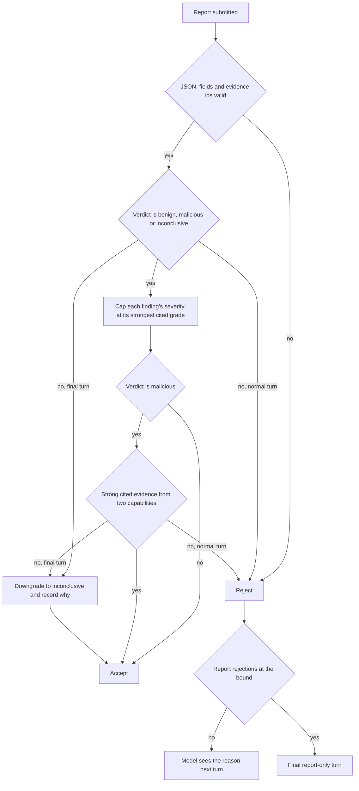
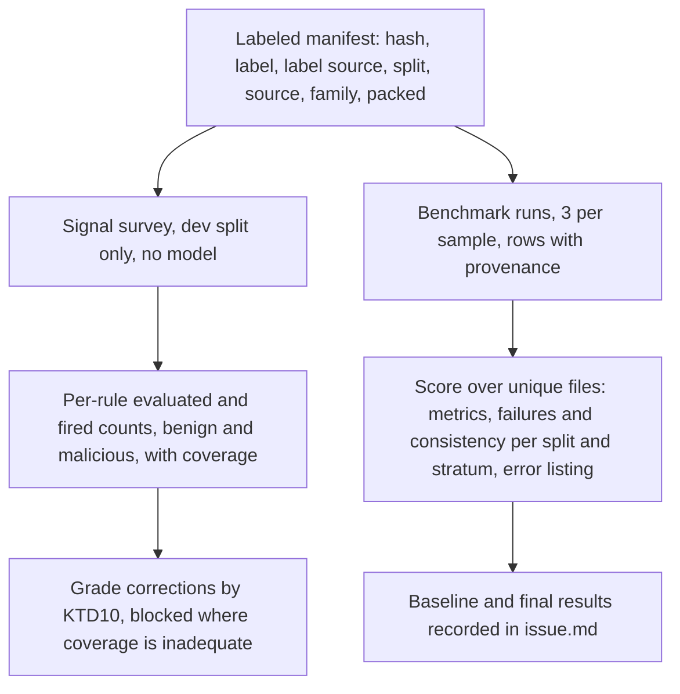

# Static Verdict Reliability - Plan

## Goal Capsule

- **Objective:** A `malicious` verdict from MIRA's static investigator stands on corroborated strong evidence, so ordinary Windows files such as `notepad.exe` are no longer called malicious for traits most Windows programs share. The false-positive and detection rates are measured on a labeled sample set, not on one file.
- **Means:** A labeled benchmark with reliability metrics and a no-model signal survey (KTD9–KTD12), evidence grades backed by benign firing rates (KTD1, KTD10), and a deterministic verdict gate in the reasoning loop (KTD2–KTD7).
- **Authority:** Product Contract Key Decisions outrank the KTDs, and the KTDs outrank the unit text. On behavior, the requirement wins. On mechanism, the KTD wins. Three earlier plans keep their authority where this plan does not override them: `docs/plans/2026-09-14-1337-feat-specialist-finding-contract-plan.md` (what crosses the specialist boundary), `docs/plans/2026-09-15-1200-feat-static-agent-working-memory-plan.md` (notes, recall, evidence minting), and `docs/plans/2026-10-11-0438-feat-static-retrieval-pipeline-plan.md` (collection, digests, the benchmark harness).
- **Stop conditions:**
  - Stop and ask if a change would alter the FINDING payload in `mira/agents/base.py`.
  - Stop after U4 if no labeled samples or no model key are available. Finish U6 and U8 and their tests without them, skip U7 (it needs survey rates), and claim no reliability improvement.
  - Stop after U9 and present the measured comparison. Claim-to-evidence relevance checks and the hypothesis-tracking additions start only on the user's decision.
  - Change no grade whose survey coverage is inadequate (KTD10). Stop and ask before raising any grade.
- **Execution profile:** One commit per unit, in dependency order. U1 lands before the branch is next pushed. U5 records the baseline after U4 and before any verdict-affecting change (U6, U7, U8).
- **Tail ownership:** `ce-work` implements U1–U4 and U6–U8. The user supplies and labels the samples, provides the model credentials, runs U5 and U9 (each benchmark pass takes hours), and decides whether U1 rewrites the unpushed commit.

---

## Product Contract

### Summary

This plan makes MIRA's static verdicts measurable first, then constrains them in code. It adds a labeled benchmark that reports false-positive rate, precision, recall, MCC, abstention, coverage and failures over unique files, and a no-model survey of how often each evidence rule fires on benign and malicious files. Evidence grades are corrected from those rates where the survey is adequate, and the model sees each grade. A deterministic gate then accepts only three verdicts, caps finding severity at the cited evidence's grade, and requires strong cited evidence from two different capabilities for `malicious`. The gate enforces a structural evidence policy. It does not prove that any claim is correct.

### Problem Frame

MIRA judged the genuine, catalog-signed `C:\Windows\System32\notepad.exe` malicious in 11 benchmark runs (`issue.md`). Four normalizer defects were fixed: the function-density signal, capa grading, section names, and debugger imports. The verdict is still malicious, for reasons code does not yet control:

- The model re-reads raw capability output and reaches its own conclusions. In the last run, it read near-zero entropy in the `fothk` section as evidence of encryption, which is backwards.
- Report validation checks only that cited evidence ids exist. A URL string was cited in support of a section claim.
- Nothing requires strong evidence for a malicious verdict. The model also chooses each finding's severity freely.
- URL strings are graded strong, and two capa anti-analysis hits on Notepad stay strong. A single "one strong item" rule would therefore still pass Notepad.
- The default objective, "Identify suspicious behavior", primes the model to find something suspicious.
- Every fix so far was checked on Notepad alone, at one to three runs per revision. There is no labeled sample set, so no fix has a measured false-positive or detection effect.

A reliability proposal inspired by Project Ire (pasted into the planning session) set the direction: keep an auditable evidence chain, let MIRA abstain, keep deterministic controls outside the model, and measure on diverse labeled samples. Much of its hypothesis tracking already exists in working memory. This plan takes the measured slice of it.

### Requirements

**Measurement**

- R1. Each benchmark sample records its SHA-256, label, label source, labeling date, split (`dev` or `test`), and, where known, its source, malware family, and packed status. A run refuses a sample whose file no longer matches its recorded hash.
- R2. Each benchmark row records the code revision with a dirty flag, the model name, the endpoint host, the objective, and the sample hash.
- R3. The benchmark scores each unique file (by SHA-256) once, by the majority verdict of its runs. It reports, per split and per stratum (benign source, malware family, packed status, where labels permit): benign false-positive rate, precision, recall, F1, MCC, abstention, coverage, failed-run rate and failed-sample rate. Run consistency is reported separately from correctness. Each figure carries its sample count, and each rate carries a 95% interval.
- R4. Each false positive, false negative, inconclusive malicious sample, and failed sample is listed with its findings, their cited evidence ids, and its trace, so a reviewer can assign a failure category.
- R5. A dev-split baseline is recorded before any change that can alter a verdict lands.
- R6. The test split is measured once, at the end. It is never used to choose a grade, threshold, or prompt wording.
- R7. The default objective asks for a verdict without presuming suspicion. The CLI, the web console, and the benchmark use the same default.

**Verdict gate**

- R8. A report's verdict is `benign`, `malicious`, or `inconclusive`.
- R9. A finding's severity does not exceed the grade of the strongest evidence it cites.
- R10. A `malicious` verdict requires strong evidence from at least two different capabilities among the evidence its findings cite. This is source diversity, not proven independence (KTD4).
- R11. **Deferred (KTD7).** A `malicious` verdict should become `inconclusive` only when a hypothesis supported by the report's cited strong evidence has a genuinely unresolved contradiction. Today's working memory cannot mark a contradiction resolved or unresolved, so in this plan the gate records each hypothesis that is supported by cited strong evidence and lists contradicting evidence, and leaves the verdict unchanged.
- R12. Rejected reports have their own bound. When the bound is reached, or when a final-turn report fails the gate, the run returns `inconclusive` and records the submitted verdict and the validator's reasons.
- R13. Every submitted report reaches the trace with the validator's outcome, whether it was accepted, repaired, downgraded, or rejected, and with the strong evidence that no finding cites.

**Evidence interface**

- R14. Each evidence line in the prompt names its grade: weak, moderate, or strong.
- R15. The prompt states that evidence lines are MIRA's graded conclusions and that raw values in the capability history are source data. It states that low entropy indicates padding or repetitive data, not encryption, and that a capability is not intent.
- R16. Every grade this plan changes is backed by an adequate dev survey (KTD10): benign and malicious evaluated and fired counts, recorded beside the grade. A rule whose survey is inadequate keeps its grade and is listed as unsurveyed.

**Configuration**

- R17. The model endpoint and model name come from the environment. The code names no deployment.

### Key Decisions

- **Plan the measured slice only, then re-plan from its measurements.** (session-settled: user-approved — chosen over one plan for all six phases of the reliability proposal: later phases should be shaped by measured failures, not by Notepad.) Governs R5, R6.
- **Defer claim-to-evidence relevance checks.** (session-settled: user-approved — chosen over evidence categories now, or a second model judging each claim: code cannot check relevance while evidence is a sentence and a number, and a model judge breaks the rule that checks live in code.)
- **An unresolved contradiction forces `inconclusive`.** (session-settled: user-approved — chosen over requiring the report to address the contradiction: a model can always write an answer, while code can check the notes. Revised 2026-10-11 by the user: the rule applies only to a genuinely unresolved contradiction, not to any hypothesis with both supporting and contradicting evidence, and it is deferred until working memory can represent resolution.) Governs R11.
- **Move the endpoint into the environment first, before the next push.** (session-settled: user-approved — chosen over tracking it separately: once pushed, the Azure resource name stays in the remote history.) Governs R17.
- **The user supplies the malicious samples, stored outside the repo, read only.** (session-settled: user-approved — chosen over MIRA fetching samples: label provenance and safe storage belong to the user.) Governs R1.
- **Evidence is minted by code only; recalled text is never citable.** (session-settled: user-approved — chosen over letting the model cite recalled output: carried from the working-memory plan, decided 2026-10-10.) The gate therefore counts only minted evidence. Governs R10, R11.
- **Signature verification stays deferred.** (session-settled: user-approved — chosen over an embedded-signature check: System32 files are catalog-signed, so an embedded-only check would call them unsigned.)

### Success Criteria

- `notepad.exe` gets no `malicious` verdict in any of 3 runs at the final revision.
- The dev benign false-positive rate is lower than the baseline's. The test-split false-positive rate is reported with its interval, beside recall, abstention, coverage and failure rates.
- A false-positive drop that comes only from more abstention or more failures is reported as such, not as a detection gain.
- A reviewer can trace any final verdict to its cited evidence, each item's grade, the strong evidence left uncited, and the validator's outcome, using the trace alone.
- Results at the pilot size (ten benign and ten malicious files per split) are reported as pilot evidence, not production reliability. Without a labeled benchmark run at both the baseline and the final revision, no reliability improvement is claimed.

### Scope Boundaries

- No change to the FINDING payload (`mira/agents/base.py`).
- No gate on `benign` verdicts. A benign verdict with strong uncited evidence is a false negative, and the benchmark measures it. The trace lists that uncited evidence (R13).
- No semantic check of claims. The gate enforces structure: allowed verdicts, the grade of each cited item, and how many capabilities the strong cited items come from. A report can pass it with cited evidence that does not support its claims.
- No hiding of raw capability output from the prompt. Recall exposes it anyway, and the digest is what makes recall usable. The plan constrains the output instead (R9, R10).

#### Deferred to Follow-Up Work

- Claim-to-evidence relevance checks, which need typed evidence categories. `mira/agents/static/evidence.py` names where that vocabulary would go.
- Evidence-dependency tracking, so corroboration counts independent facts rather than capabilities (KTD4).
- Hypothesis tracking additions: `rejected` and `unresolved` statuses in working memory (today limited to `open`, `supported`, `weakened`), and tying each capability call to a stated question. The automatic contradiction downgrade (R11, KTD7) waits on an explicit unresolved status.
- A separate rejection budget for reports that still spend `tool_call_count` (kept as today).
- Deeper behavioral analysis: targeted disassembly, call references, control flow.
- Signature and catalog verification (WinVerifyTrust).
- Dynamic or sandbox analysis.
- Caching capability results across benchmark runs. A run re-executes every capability, and capa alone takes 84–150 s.
- Large-artifact handling (overlays, installers), discussed in `context.md`.

---

## Planning Contract

### Key Technical Decisions

- KTD1. **Grade bands live in `mira/core/evidence.py`, beside `Evidence.confidence`.** Weak is below 0.6, moderate is 0.6 up to 0.8, strong is 0.8 and above. Static's `CONFIDENCE_*` constants keep their values and are checked against the bands. The loop reads a grade through core, so `mira/reasoning` never imports a specialist. Rationale: one owner for what "strong" means, and the loop stays specialist-agnostic.
- KTD2. **The verdict policy is a new module, `mira/reasoning/runtime/verdict.py`, called from `AgentLoop._parse_report`.** It is pure: it takes the parsed report, the typed findings, the run's evidence and the final notes, and it returns the adjusted report plus repairs, a failure reason, and a validation record. The record lists the strong evidence no finding cites (`uncited_strong`) and the hypotheses KTD7 records (`contradicted_hypotheses`). Rationale: `_parse_report` serves the normal turn, the final report turn and the `_supported_part` salvage, so every path passes the gate. `narrative.py` is the precedent for a validation module beside the loop. **Guarantee:** the gate enforces structural evidence policy (allowed verdicts, cited grades, capability diversity). It is not semantic proof that a cited item supports its claim or that a claim is correct. That needs the deferred relevance checks.
- KTD3. **The verdict is matched after trimming whitespace and lowercasing; anything else is a failure.** A failure lists the three allowed values. There is no fuzzy matching: "suspicious" is a different claim, not a typo.
- KTD4. **Corroboration means strong cited evidence from at least two different capabilities. This is source diversity, not guaranteed independence.** "Cited" means named in any finding's `evidence_refs`. "Capability" is the evidence item's `capability` field, so `run_capa` and `scan_yara` count separately, and two strong `run_capa` items count once. Two capabilities can report different observations derived from one underlying fact: a `CheckRemoteDebuggerPresent` import seen by `list_imports` and a capa anti-debugging rule matching that API, or a URL found by `extract_strings` and a YARA rule matching the same string. Such a pair passes the rule on a single fact. This phase builds no evidence-dependency tracking (Deferred). U9 reviews each false positive and missed detection for this limitation. Rationale: one rule engine can fire twice on ordinary runtime code, which is Notepad's remaining case (two capa anti-analysis hits). A second source is the minimum a malicious claim needs, though it is not enough by itself. Cost: malware whose only strong evidence comes from one capability becomes `inconclusive`, an abstention rather than a benign miss. The benchmark measures this cost (Risks).
- KTD5. **The severity cap repairs the report instead of rejecting it.** Weak caps at `low`, moderate caps at `medium`, and strong is uncapped. A finding that cites nothing (allowed only when no evidence exists) caps at `info`. Each lowering is counted in the output metadata as `severities_capped`. Rationale: severity is the model's opinion, while the grade is code's measurement. Rejecting would spend a turn on a mechanical fix.
- KTD6. **A gate failure rejects on a normal turn and downgrades on the final report turn.** A rejection reaches the model as a harness observation, as today, so it can gather corroboration or change the verdict. `CompletionChecker` counts rejected reports against `MAX_REPORT_REJECTIONS = 3`, beside `MAX_MEMORY_REJECTIONS`. Reaching the bound ends the run with the completion reason `limit_reports`, which still gets the final report-only turn. A downgrade sets the verdict to `inconclusive`, adds a bracketed note to the summary (as `_supported_part` does), and records the submitted verdict and reasons in metadata under `verdict_gate`.
- KTD7. **The automatic contradiction downgrade is deferred, because working memory cannot tell a resolved contradiction from an unresolved one.** The rule is meant for a genuinely unresolved contradiction. A hypothesis that lists both supporting and contradicting evidence may be sound reasoning: the model weighed the counterevidence and still holds it. Today's state represents resolution only indirectly, and none of these signals is reliable:
  - `status` is `open`, `supported` or `weakened` (`PROVISIONAL` in `mira/core/hypothesis.py`). `supported` with contradicting ids can mean the contradiction was weighed or that it was ignored. `open` is also the state of any hypothesis the model never revisited.
  - `contradicting_evidence` is a model-editable list. A revision replaces it, including with `[]` (`narrative.py`), so an empty list can mean resolved or erased.
  - `close` removes the hypothesis entirely.

  So the gate does not change a verdict for contradictions in this plan. It reads the final `WorkingMemory` and records, in the validation record, each hypothesis whose `supporting_evidence` includes a cited strong item and whose `contradicting_evidence` is non-empty (`contradicted_hypotheses`). U9 counts these, which decides whether the deferred `unresolved` status is worth building. When the downgrade lands, it should downgrade rather than reject: rejecting would teach the model to delete contradicting ids from its notes to pass.
- KTD8. **Evidence lines show the grade word, not the number.** The format is `E4 [extract_strings, weak] ...`. Rationale: the model must know which evidence the gate counts. A number invites false precision. This reverses the current rule that the model sees only the sentence (`issue.md`).
- KTD9. **The signal survey calls `normalize()` directly, and each `Signal` gains a `rule` key.** Examples: `imports:anti-debugging`, `strings:URL`, `capa:<rule_id>`, `yara:<namespace>/<rule>`, `section:nonstandard-name`, `section:high-entropy`. The key is internal: it does not reach `Evidence`, the prompt, or the gate. Rationale: signals are prose, and rates need a stable key per rule. Calling `normalize()` with `build_executor` results avoids minting evidence and needs no model.
- KTD10. **A grade's ceiling follows its benign firing rate. The bounds are provisional rules.** Strong allows a benign rate of at most 5%. Moderate allows above 5%, up to 20%. Above 20% is weak. The bound is a ceiling, not a qualification: a low benign rate shows a signal is rare, not that it indicates malware, so the survey never raises a grade by itself. Malicious firing rates and sample counts are recorded beside every benign rate.
  - **Adequacy.** A rule's rates count only when the survey is adequate for it: at least 50 benign dev samples evaluated successfully for the rule, and successful evaluation on at least 90% of the benign samples attempted for its capability. Otherwise the grade does not change, in either direction, and zero firings prove nothing. Even at 50 samples, 0 firings has a Wilson upper bound near 7%, which is why the bounds stay provisional.
  - **Changes.** A rule above its ceiling, on an adequate survey, is lowered (U7). Raising a grade is the user's decision and needs an adequate survey plus its malicious rate (Stop conditions). A single capa or YARA rule can be lowered by name through a frozenset, like `STANDARD_SECTION_NAMES`. Each changed grade carries a comment with its benign and malicious evaluated and fired counts and the survey date, following the existing System32 survey comments.
  - Rationale: these bounds encode the decisions already taken (`fothk` at 81% made standard, `IsDebuggerPresent` at 60% made weak, anti-debug checks at 0.9–6% kept strong, all on 2,111 System32 files) as one rule instead of per-case judgement.
- KTD11. **Metrics count each unique file once, by its majority verdict.** A file is unique by SHA-256, so a file listed twice is scored once over all its runs. The same hash with two labels stops `score` with an error naming the hash. The majority is taken over the file's successful runs. A tie is `inconclusive`. The positive class is `malicious`, and `inconclusive` counts as "not malicious" for precision, recall, F1 and MCC, so abstaining on malware costs recall.
  - **Failures.** A file with no successful run is a failed sample. It is excluded from the classification metrics and counted in the failed-sample rate. The failed-run rate is failed rows over all rows. Abstention and coverage are over files with at least one successful run.
  - **Consistency** is reported separately from correctness: the share of files whose successful runs all agree, and each file's majority share. A file whose runs agree on a wrong verdict is consistent and wrong.
  - **Strata.** Results are reported per split, then by `source`, `family` and `packed` within the split. A blank value groups as `unlabeled`.
  - **Uncertainty.** Every rate prints its k of n and a Wilson 95% interval, computed with the standard library. F1 and MCC are not proportions, so they print beside the confusion-matrix counts without an interval. An undefined metric prints `n/a`.
  - Labels other than `benign` and `malicious` (for example `pua`, `unsupported`) get a verdict distribution only.
  - Rationale: runs of one file are correlated, so per-run counts would overstate confidence. Treating abstention as a miss stops "always inconclusive" from looking good. Excluding failures from the matrix without reporting their rate would let failures hide errors.
- KTD12. **The manifest stays a CSV, read by header.** `path` and `label` are required. `sha256`, `label_source`, `labeled_on`, `split`, `source`, `family` and `packed` are optional, so existing `path,label` manifests (`runs/benchmarks/manifest_notepad.csv`, the tests) still read. `source` says where the file came from (for example `system32`, `third-party`, `malwarebazaar`). `packed` is `yes`, `no` or blank. The revision comes from `git rev-parse HEAD` plus a dirty check, once per benchmark, and is `unknown` without git.
- KTD13. **`MODEL_BASE_URL` and `MODEL_NAME` are required environment variables, read where `MODEL_API_KEY` is read.** A missing one raises with its name. There is no default, so a missing setting cannot silently target a stale deployment. Scripted models still need none of them.
- KTD14. **One default objective, `DEFAULT_OBJECTIVE` in `mira/reasoning/main.py`.** The web console and the benchmark already import from that module. Wording: "Determine whether this file is malicious, benign, or undetermined from static evidence." `mira/web/dashboard.html` and `README.md` carry the same text.
- KTD15. **Prompt guidance goes in two places in `mira/reasoning/definition/instructions.py`.** The evidence guidance (R15) replaces the one-line "How to evaluate evidence" section in U6. The verdict rule (three verdicts, corroboration, abstention allowed) goes in "When to stop" in U8, so the prompt never states a rule that code does not yet enforce.

### High-Level Technical Design

Report validation, after U8. The existing schema checks run first and are unchanged.

Every outcome in this flow, including each repair, reaches the trace (R13). So do the strong evidence no finding cites and the hypotheses KTD7 records. Neither changes the verdict.

Measurement flow. The survey and the benchmark share the manifest. Only the benchmark calls the model.

### Alternatives Considered

- **A second model judges whether each cited item supports its claim.** Rejected: it adds a model that can be wrong in the same way, and it breaks the rule that controls live in code. Typed categories are the deterministic route, and they are deferred.
- **Strip raw values from the prompt so the model cannot re-grade them.** Rejected: `recall_observation` returns raw slices by design, and the digest is what the model uses to form a recall. Constraining the verdict and severity holds wherever the model reads.
- **One strong cited item is enough for `malicious`.** Rejected per KTD4: Notepad's two capa anti-analysis hits would pass it.
- **Track evidence lineage so corroboration counts independent facts.** Deferred per KTD4: it needs typed evidence lineage across normalizers. U9 measures first how often shared-fact corroboration causes an error.
- **Gate `benign` verdicts symmetrically.** Deferred: false negatives are measured first, and no failure of that kind has been observed yet.

### System-Wide Impact

- **Every specialist's loop.** `verdict.py` runs in the shared reasoning loop. It reads only core concepts (evidence grade, capability name, working-memory hypotheses), so a future dynamic or forensic specialist inherits the gate unchanged.
- **Prompt context.** U6 and U8 change the text of every run's prompt. A baseline recorded before them is only comparable when the model and endpoint stay the same (R2 records both).
- **Output and trace consumers.** `FinalOutput.metadata` gains `severities_capped`, `report_rejections` and, on a downgrade, `verdict_gate`. Completion reasons gain `limit_reports`. The web console (`mira/web.py`, `mira/web/dashboard.html`) and `scripts/benchmark_static.py` display these as strings. The trace gains report-turn records with a validation field carrying the outcome, reasons, repairs, `uncited_strong` and `contradicted_hypotheses`.
- **FINDING payload.** Unchanged. The assessment already leads with the verdict, so a downgraded verdict reaches the orchestrator through the existing `assessment` text.

### Dependencies / Prerequisites

- `MODEL_API_KEY`, `MODEL_BASE_URL` and `MODEL_NAME` set for U5 and U9.
- A labeled sample set, supplied by the user, with disjoint `dev` and `test` splits:
  - Benign dev: System32 executables and DLLs. The survey uses a larger dev-only benign pool, since it costs no model calls: at least 50 files evaluated per capability, `run_capa` included (KTD10).
  - Benign test: a different source, such as signed third-party programs, so a System32-calibrated grade is tested away from System32.
  - Malicious: a labeled source such as MalwareBazaar, with different families in each split, including packed samples.
  - A few PUA and malformed or non-PE files, labeled `pua` and `unsupported`.
  - Every file under the artifact size limit (64 MB).
- Storage: outside the repo, in a folder Windows Defender excludes, or in a VM. Samples are read by the isolated capability workers and never executed.
- Time: one run takes about 4 minutes (Notepad: 243 s). Ten benign and ten malicious samples at 3 runs each take about 4 hours per pass. capa takes 84–150 s per file in the survey.

### Risks

| Risk | Mitigation |
|---|---|
| Small samples give wide intervals, so a real improvement may not be distinguishable from noise. | Report intervals and counts with every rate (R3). Claim only what the intervals support. Use the cheaper survey for grade work. |
| Corroboration (KTD4) lowers recall on malware with a single strong source. | It shows as abstention, not a benign miss. U9 lists every malicious sample that went `inconclusive` with its strongest evidence, so the rule can be revisited with data. |
| Two capabilities corroborate from one underlying fact (KTD4), so a false positive passes the gate. | Documented limitation. U9 checks each false positive's corroborating items for a shared fact and counts them. Dependency tracking is deferred until that count justifies it. |
| Without the contradiction downgrade (KTD7), a `malicious` verdict stands on a hypothesis with unresolved counterevidence. | The gate records each such hypothesis in the trace, and U9 counts them among false positives and true positives. That count decides whether the deferred `unresolved` status is built. |
| Grades get tuned to the dev set and fail on the test set. | Grades change only by the KTD10 rule, never per sample, and only on an adequate survey. The test split comes from different sources and is run once (R6). |
| A tiny or failure-ridden survey makes a rule look rare. | KTD10's adequacy bounds block any grade change below 50 evaluated benign samples or 90% coverage. Failed capabilities count as not evaluated (U4). |
| Label noise in public malware feeds. | `label_source` and `labeled_on` per sample (R1). FP and FN review includes "label uncertainty" as a category. |
| A model or endpoint change between baseline and final run confounds the comparison. | Rows record both (R2). If they change, re-record the baseline. |
| Parsing hostile files exercises third-party parsers (pefile, capa, YARA). | Unchanged from today's product use: capabilities run in isolated workers, and samples are never executed. Keep the samples on an excluded path or in a VM. |

---

## Implementation Units

### U1. Model endpoint from the environment

- **Goal:** The model adapter reads its endpoint and model name from the environment and names no deployment.
- **Requirements:** R17. Key Decision: endpoint first.
- **Dependencies:** None.
- **Files:** `mira/reasoning/model/adapter.py`, `README.md`, `tests/test_model_adapter.py`
- **Approach:**
  1. Replace the `BASE_URL` and `DEFAULT_MODEL` constants with required reads of `MODEL_BASE_URL` and `MODEL_NAME` (KTD13).
  2. Keep the resolved model name and endpoint host readable on the adapter, for U2's row provenance.
  3. Make the class docstring provider-neutral (it still says "Azure-hosted Grok").
  4. Document the three variables in `README.md`.
- **Execution note:** Land before the branch is next pushed. Whether to fold this change into the unpushed commit `0b25376` is the user's decision (Open Questions).
- **Patterns to follow:** The `MODEL_API_KEY` check in `ModelAdapter.__init__`. `load_env` in `mira/reasoning/composition.py` already fills these from `.env`.
- **Test scenarios:**
  - With all three variables set, the adapter's client uses that base URL and the adapter uses that model name.
  - With `MODEL_BASE_URL` unset, construction raises an error naming `MODEL_BASE_URL`.
  - With `MODEL_NAME` unset, construction raises an error naming `MODEL_NAME`.
  - A loop built with a scripted model runs with none of the variables set.
- **Verification:** `adapter.py` contains no hostname, and the full suite passes.

### U2. Labeled manifest, run provenance, and a neutral objective

- **Goal:** Benchmark samples carry hash, label provenance, split, source, family and packed status. Rows carry revision, model, endpoint host, objective and hash. One neutral default objective is used everywhere.
- **Requirements:** R1, R2, R7.
- **Dependencies:** U1.
- **Files:** `scripts/benchmark_static.py`, `mira/reasoning/main.py`, `mira/web.py`, `mira/web/dashboard.html`, `README.md`, `tests/test_benchmark.py`, `tests/test_web.py`
- **Approach:**
  1. Read the manifest by header (KTD12).
  2. Hash each sample before its runs. A mismatch with a recorded `sha256` produces a failed row ("hash mismatch"), and the remaining samples still run.
  3. Add `sha256`, `split`, `source`, `family`, `packed`, `label_source`, `revision`, `dirty`, `model`, `endpoint_host` and `objective` to every row. `sha256` is the computed hash, recorded or not, so U3 can count unique files. A scripted model records `model: scripted`.
  4. Add a `--split` filter to `run`, so dev and test run separately.
  5. Define `DEFAULT_OBJECTIVE` (KTD14) and use it in the CLI, the web form default and the benchmark default.
- **Patterns to follow:** The failed-row handling in `run_sample`. The `ImportsThenReport` double and `manifest()` helper in `tests/test_benchmark.py`.
- **Test scenarios:**
  - A manifest with every column produces rows carrying `sha256`, `split`, `source`, `family`, `packed` and `label_source`.
  - A legacy `path,label` manifest still runs. Its rows carry the computed `sha256` and leave the other new sample fields empty.
  - A sample whose bytes differ from its recorded hash produces a failed "hash mismatch" row, and the next sample still runs.
  - `--split dev` runs only the dev rows.
  - Every row carries a revision, a dirty flag, a model, an endpoint host and the objective.
  - The CLI default, the web form default and the benchmark default are the same string.
- **Verification:** A run over a minimal-PE manifest produces rows with every provenance field.

### U3. Reliability metrics and error listing

- **Goal:** A `score` subcommand that computes the reliability metrics over unique files and lists every error, abstention on malware, and failure.
- **Requirements:** R3, R4, R6.
- **Dependencies:** U2.
- **Files:** `scripts/benchmark_static.py`, `tests/test_benchmark.py`
- **Approach:**
  1. Group rows by `sha256` and take each file's majority verdict over its successful runs (KTD11). Stop on a hash with two labels.
  2. Count failed runs and failed samples, and exclude failed samples from the classification metrics (KTD11).
  3. Build the confusion matrix over unique files and compute FPR, precision, recall, F1, MCC, abstention and coverage. Every rate prints k of n and a Wilson interval.
  4. Report consistency separately: the share of files whose successful runs all agree, with its interval.
  5. Report per split, then by `source`, `family` and `packed` within the split. Give `pua` and `unsupported` labels a verdict distribution only.
  6. List each false positive, false negative, inconclusive malicious file and failed file with its label, majority verdict, consistency, finding titles with cited ids, and trace paths. The web console's evidence explorer resolves the ids.
  7. Keep `compare` unchanged.
- **Patterns to follow:** `compare` and its helpers (`_by_sample`, `_verdicts`, `_majority`) in the same script.
- **Test scenarios:**
  - Two benign files (one judged malicious) and two malicious files (one malicious, one inconclusive) give FPR 1/2, recall 1/2, precision 1/2, abstention 1/4 and coverage 3/4.
  - A file with runs malicious, benign, malicious has majority `malicious` and is not unanimous.
  - The same file listed twice under two paths counts once in the confusion matrix, with all its runs in its majority.
  - The same hash with labels `benign` and `malicious` stops `score` with an error naming the hash.
  - A three-way tie becomes `inconclusive`.
  - A file whose three runs all fail is a failed sample, absent from the confusion matrix, and the failed-sample rate is 1 of n. One failed run of three is counted in the failed-run rate, and the file is scored on its two successful runs.
  - A benign file judged malicious in all three runs is unanimous and a false positive: consistency and correctness are reported apart.
  - Files with `family` blank group as `unlabeled`, and per-family rows print their own counts and intervals.
  - With no malicious files, recall and MCC print `n/a`, and nothing crashes.
  - The Wilson interval for 0 of 10 has lower bound 0 and an upper bound near 0.28.
  - `pua` rows appear in a distribution and not in the confusion matrix.
  - The listing names each false positive, false negative, inconclusive malicious file and failed file, with findings, cited ids and trace paths.
- **Verification:** `score` on hand-built rows matches the hand-computed metrics.

### U4. Signal survey

- **Goal:** A no-model script that reports, for each evidence rule, how many benign and malicious dev samples it was evaluated on and fired on, and whether the survey is adequate to change its grade.
- **Requirements:** R16, R6.
- **Dependencies:** U2 (manifest reader), U3 (Wilson interval).
- **Files:** `mira/agents/static/evidence.py`, `scripts/survey_signals.py`, `tests/test_signal_survey.py`, `tests/test_static_evidence.py`
- **Approach:**
  1. Add the `rule` key to `Signal` and set it in every normalizer (KTD9).
  2. For each dev sample, build a client and executor, call the capabilities in a fixed order with default arguments (`file_info` and `analyze_pe` first, because later normalizers read them as `prior`), and call `normalize()` on each result.
  3. Skip `disassemble_function`, which needs an address the model chooses. Add a `--skip` option so a large benign pool can run without `run_capa`. A skipped capability is not attempted, and it is not a failure.
  4. A sample counts as evaluated for a rule only when the rule's capability and every capability its normalizer reads as `prior` succeeded. A failed capability counts as not evaluated, never as a rule that did not fire.
  5. Print one row per rule: current grade; benign evaluated and benign fired; malicious evaluated and malicious fired; failed evaluations; coverage (evaluated over attempted, per label); each rate with its Wilson interval; and the KTD10 ceiling, or `blocked: coverage` when the survey is inadequate for that rule.
  6. Exclude test-split rows (R6).
- **Patterns to follow:** `build_client` and `build_executor` in `mira/agents/static/wiring.py`. The manifest reader and the spawn guard in `scripts/benchmark_static.py`.
- **Test scenarios:**
  - Every normalizer's signals carry a rule key. The same input always gives the same key, and different categories give different keys.
  - A rule firing on 1 of 4 benign and 3 of 4 malicious samples reports both counts, both evaluated totals and both rates.
  - A sample whose capability failed is counted under failed evaluations and is absent from that rule's evaluated and fired counts.
  - A sample whose `analyze_pe` failed is not evaluated for a section rule that reads it as `prior`.
  - A rule with 0 fired of 10 evaluated benign samples shows `blocked: coverage`, not a strong ceiling.
  - A rule with 50 benign samples evaluated but 85% coverage shows `blocked: coverage`. At 90% coverage it shows its KTD10 ceiling.
  - A test-split row is excluded.
  - A survey of the minimal PE with `run_capa` and `scan_yara` skipped completes, prints the table, and reports no failures for the skipped capabilities.
- **Verification:** A survey run over dev benign samples prints per-rule counts, coverage and ceilings.

### U5. Record the dev baseline and survey

- **Goal:** Baseline numbers and survey rates are recorded before any verdict-affecting change.
- **Requirements:** R5, R3, R16.
- **Dependencies:** U2, U3, U4. User-supplied samples and model credentials.
- **Files:** `issue.md`. Run outputs stay in `runs/benchmarks/`, which git ignores.
- **Approach:**
  1. The user builds the manifest per Dependencies / Prerequisites.
  2. Run the dev split at 3 runs per sample on the U4 revision, then score it.
  3. Run the survey on the dev split, with capa on a subset of at least 50 benign files when the benign pool is large (KTD10).
  4. Append a baseline section to `issue.md`: revision, model, endpoint host, objective, unique-file counts per split and stratum, metrics with intervals, failure rates, consistency, each false positive, false negative, inconclusive malicious file and failed file with its failure category, and each strong and moderate rule's evaluated and fired counts, coverage, and whether coverage blocks a change.
- **Test expectation:** none -- measurement only, no code change.
- **Verification:** `issue.md` holds the baseline section with every field above.

### U6. Grade bands in core and graded evidence in the prompt

- **Goal:** One definition of each grade, a grade on every evidence line, and the evidence guidance in the prompt.
- **Requirements:** R14, R15.
- **Dependencies:** U5.
- **Files:** `mira/core/evidence.py`, `mira/agents/static/evidence.py`, `mira/reasoning/runtime/context.py`, `mira/reasoning/definition/instructions.py`, `tests/test_static_evidence.py`, `tests/test_context.py`
- **Approach:**
  1. Add the band thresholds and a grade lookup to `mira/core/evidence.py` (KTD1).
  2. Keep static's `CONFIDENCE_*` values, and test that each one falls in the band its name implies.
  3. Render the grade word on each evidence line in `render_state` (KTD8).
  4. Replace the "How to evaluate evidence" section with the R15 guidance (KTD15).
- **Patterns to follow:** The existing evidence-line rendering in `render_state`. The section style in `assemble_instructions`.
- **Test scenarios:**
  - Confidence 0.4 grades weak, 0.6 moderate, 0.79 moderate, 0.8 strong, and 1.0 strong.
  - `CONFIDENCE_STRONG` and `CONFIDENCE_RULE_MATCH` grade strong, `CONFIDENCE_MODERATE` moderate, and `CONFIDENCE_WEAK` and `BASE_CONFIDENCE` weak.
  - An evidence line shows the capability and the grade word, and never the confidence number.
  - The prompt contains the three guidance points: conclusions versus source data, low entropy as padding not encryption, capability not intent.
  - The existing context tests pass with the new line format.
- **Verification:** A prompt rendered for a run with three evidence items shows three graded lines.

### U7. Grade corrections from the survey

- **Goal:** Every moderate or strong rule whose adequately surveyed benign rate breaks its KTD10 ceiling is lowered. No grade is raised.
- **Requirements:** R16.
- **Dependencies:** U5, U6.
- **Files:** `mira/agents/static/evidence.py`, `tests/test_static_evidence.py`, `issue.md`
- **Approach:**
  1. Apply KTD10 to every moderate and strong rule in the U5 survey. A rule marked `blocked: coverage` keeps its grade and is listed in `issue.md` as unsurveyed.
  2. Likely candidates are URL strings (strong today), registry paths (moderate today), capa anti-analysis rules that fire on System32, and YARA rules that fire on benign files. The survey decides the list, not this plan.
  3. Lower a single capa or YARA rule by name, through a named frozenset.
  4. Word a lowered signal's sentence so it states the benign prevalence, as the debugger-import wording does.
  5. Comment each change with its benign and malicious evaluated and fired counts and the survey date.
- **Execution note:** Change no grade without an adequate survey for that rule. Notepad alone justifies no change. A rule that looks under-graded goes to the user with its counts, not into the code.
- **Patterns to follow:** `CRT_DEBUG_IMPORTS` and `STANDARD_SECTION_NAMES` with their survey comments.
- **Test scenarios:**
  - Each lowered rule yields its new confidence and its prevalence wording for an input that triggers it.
  - An unchanged strong rule, such as process-injection imports, still yields strong.
  - A capa hit on a rule lowered by name is weak, while another hit in the same namespace stays strong.
- **Verification:** A survey rerun on the dev split shows no adequately surveyed strong or moderate rule above its KTD10 ceiling, and `issue.md` lists every rule whose coverage blocked a change.

### U8. Verdict gate and report audit

- **Goal:** Code enforces the structural verdict rules, and every submitted report reaches the trace with its validation outcome and the strong evidence it left uncited. The gate's guarantee is structural, not semantic (KTD2).
- **Requirements:** R8, R9, R10, R11 (recording only), R12, R13.
- **Dependencies:** U6.
- **Files:** `mira/reasoning/runtime/verdict.py` (new), `mira/reasoning/runtime/loop.py`, `mira/reasoning/runtime/completion.py`, `mira/reasoning/runtime/trace.py`, `mira/reasoning/definition/instructions.py`, `tests/test_verdict.py` (new), `tests/test_loop.py`, `tests/test_completion.py`, `tests/support.py`
- **Approach:**
  1. Write the policy in `verdict.py` (KTD2), checking in this order: verdict set (KTD3), severity cap (KTD5), corroboration (KTD4). Then fill the validation record: `uncited_strong` for every verdict, and `contradicted_hypotheses` (KTD7), neither of which changes the verdict.
  2. Call it from `_parse_report` after `_typed_findings`. Pass a "final turn" flag from `_final_report_turn` and from `_supported_part`, so the final turn downgrades instead of rejecting (KTD6).
  3. Add the report-rejection count, `MAX_REPORT_REJECTIONS` and the `limit_reports` reason to `CompletionChecker` and `_completion_reason`. Give `_final_report_turn` its reason text.
  4. Record `severities_capped`, `report_rejections` and, on a downgrade, `verdict_gate` in the output metadata. Add the downgrade note to the summary.
  5. Trace the report turn when a report is accepted with no capability call, which today is skipped. Give the trace record an optional validation field holding the validation record.
  6. State the verdict rule in "When to stop" (KTD15). The prompt says nothing about contradictions forcing `inconclusive`, since code does not enforce that yet.
- **Patterns to follow:** `mira/reasoning/runtime/narrative.py` for a validation module. `_supported_part` for the summary note. `MAX_MEMORY_REJECTIONS` in `completion.py`. The scripted models in `tests/support.py`.
- **Test scenarios:**
  - Verdict `" Malicious "` is accepted as `malicious`.
  - Verdict `suspicious` on a normal turn is rejected, and the reason lists the three allowed verdicts.
  - Verdict `suspicious` on the final report turn becomes `inconclusive`, with the submitted verdict in `verdict_gate`.
  - A `high` finding citing only weak evidence becomes `low`, and `severities_capped` is 1.
  - A `critical` finding citing one strong item stays `critical`.
  - A finding citing nothing, in a run with no evidence, becomes `info`.
  - `malicious` citing strong items from `run_capa` and `list_imports` is accepted.
  - `malicious` citing two strong `run_capa` items only is rejected on a normal turn. A following `inconclusive` report is accepted.
  - `malicious` citing only moderate evidence is rejected.
  - The two previous cases on the final report turn become `inconclusive`, with the reason in `verdict_gate` and the note in the summary.
  - Contradiction, as listed: `malicious` with corroboration, where H1 (status `supported`) is supported by a cited strong item and lists contradicting evidence, is accepted as `malicious`, and `contradicted_hypotheses` names H1.
  - Contradiction, as removed: the same run after a notes revision sets H1's `contradicting_evidence` to `[]` is accepted as `malicious`, and `contradicted_hypotheses` is empty. These two scenarios pin today's behavior, so the deferred downgrade changes them visibly when it lands.
  - A hypothesis with contradicting evidence that no cited strong item supports is not recorded and does not affect the verdict.
  - `benign` with strong evidence that no finding cites is accepted unchanged, and `uncited_strong` lists those ids in the trace.
  - `malicious` with corroboration and one more strong item left uncited is accepted, and `uncited_strong` lists that item.
  - Three rejected reports end the run with `limit_reports`, followed by one final report-only turn.
  - A final-turn report with one unsupported finding (dropped by `_supported_part`) and an uncorroborated `malicious` verdict becomes `inconclusive`.
  - An accepted report-only turn appears in the trace with its validation record, and so does a rejected one.
  - Integration: `StaticAgent.investigate` with a scripted model that submits `malicious` on weak evidence returns an assessment that begins with `inconclusive:`.
- **Verification:** The full suite passes. A report whose only strong evidence comes from `run_capa` cannot produce `malicious`. Whether Notepad's URL evidence stays strong is U7's survey result, so Notepad's live outcome is measured in U9. Passing the gate shows a report's structure is policy-compliant, not that its claims are right.

### U9. Measure and record

- **Goal:** The final revision is measured against the baseline on the dev split, then once on the test split, and the results are recorded.
- **Requirements:** R3, R4, R6. Success Criteria.
- **Dependencies:** U6, U7, U8.
- **Files:** `issue.md`
- **Approach:**
  1. If no labeled benchmark or no model credentials are available, do not run this unit. Record in `issue.md` that the code tests pass and that no reliability improvement is claimed, then stop.
  2. Run the dev split at 3 runs per sample, then score it and compare it with the U5 baseline.
  3. Report, per split and stratum, with counts and intervals: false positives, false negatives, inconclusive malicious files, failed runs and failed files, abstention, coverage, and consistency.
  4. Assign each false positive and false negative one category: normalization error, raw-evidence bypass, unsupported claim, weak evidence promoted to strong, missing counterevidence, shared-fact corroboration, label uncertainty, or tool failure or incomplete analysis. For false negatives, also note whether a capability could have shown the missed behavior and whether strong evidence was left uncited.
  5. For each false positive, check whether its corroborating strong items from two capabilities derive from one underlying fact (KTD4).
  6. List each malicious file that went `inconclusive`, with its strongest cited evidence, whether only one capability gave strong evidence (the KTD4 cost), and its `uncited_strong`.
  7. Count accepted `malicious` verdicts with a non-empty `contradicted_hypotheses`, split into true and false positives (data for the deferred KTD7 downgrade).
  8. Run the test split once, at 3 runs per sample.
  9. Record in `issue.md`: revision, model, endpoint host, objective, manifest reference with hashes, everything from steps 3–7 for both splits, and Notepad's three verdicts. At the pilot size, label the results pilot evidence, not production reliability.
  10. Stop and present the comparison.
- **Test expectation:** none -- measurement only, no code change.
- **Verification:** `issue.md` records the final measurement, or the statement that none was possible, and the Success Criteria are each answered with a number or a stated miss.

---

## Verification Contract

| Gate | Command | Applies to |
|---|---|---|
| Unit and integration tests | `.venv/Scripts/python.exe -m pytest -q` | U1–U4, U6–U8 |
| Benchmark run | `python scripts/benchmark_static.py run <manifest> --split dev --runs 3 --out runs/benchmarks/<name>.jsonl` | U5, U9 |
| Score | `python scripts/benchmark_static.py score runs/benchmarks/<name>.jsonl` | U5, U9 |
| Compare | `python scripts/benchmark_static.py compare <baseline>.jsonl <final>.jsonl` | U9 |
| Signal survey | `python scripts/survey_signals.py <manifest>` | U5, U7 |

No existing test is deleted or weakened to make a unit pass. A changed expectation states why in its test.

---

## Definition of Done

**Global**

- The full test suite passes.
- `mira/reasoning/model/adapter.py` names no deployment, and the push decision for `0b25376` is recorded.
- `issue.md` holds the baseline and the final measurement, each with revision, model, endpoint host, objective, unique-file counts, and metrics with intervals. Without a labeled benchmark or model credentials, it states instead that no reliability improvement is claimed.
- `notepad.exe` gets no `malicious` verdict in 3 runs at the final revision.
- The test-split false-positive rate is reported beside recall, abstention, coverage and failure rates. No result is claimed from one sample, and pilot-size results are not claimed as production reliability.
- Code from abandoned attempts is removed from the diff.

**Per unit**

| Unit | Done when |
|---|---|
| U1 | Missing endpoint settings fail by name. Scripted runs need no settings. |
| U2 | Rows carry every provenance field. Legacy manifests still run. One default objective. |
| U3 | `score` matches hand-computed metrics over unique files, reports failures and consistency apart, and lists every FP, FN, inconclusive malicious file and failed file. |
| U4 | Every signal has a rule key. The survey prints per-rule evaluated and fired counts, coverage and ceilings from dev samples only, and failures never count as "not fired". |
| U5 | The baseline section is in `issue.md`. |
| U6 | Evidence lines show grades. The R15 guidance is in the prompt. |
| U7 | No adequately surveyed strong or moderate rule exceeds its KTD10 ceiling. Each change carries its counts. Blocked rules are listed. |
| U8 | Every gate scenario passes. Every report reaches the trace with its validation record, including uncited strong evidence. |
| U9 | The final measurement and categories are in `issue.md`, or the statement that no reliability improvement is claimed. |

---

## Open Questions

- **Deferred, user's decision before the next push:** should U1 be folded into the unpushed commit `0b25376`, so the Azure resource name never reaches the remote? A new commit on top leaves the name in the pushed history. The earlier resource (`13ac7f7`) is already pushed either way.
- **Deferred, set at U5:** the final dev and test sizes depend on the samples the user gathers. Ten benign and ten malicious files per split is a pilot minimum, not evidence of production reliability: with ten benign files and no false positives, the 95% upper bound on the false-positive rate is still about 28%. Smaller sets give wider intervals.

---

## Appendix

### Sources

- `issue.md`: the Notepad investigation, the four fixes, what still drives the verdict, and the System32 survey figures behind the current grades.
- `mira/reasoning/runtime/loop.py`: `_parse_report`, `_typed_findings` and `_evidence_refs` (today's id-only validation), `_final_report_turn` and `_supported_part` (the salvage path), and the report-only turn that is not traced.
- `mira/agents/static/evidence.py`: grade constants, `STRING_CATEGORIES` (URL graded strong), capa namespace grading, and `_remainder`.
- `mira/reasoning/runtime/context.py`: `render_state` evidence lines, which show the sentence only.
- `mira/reasoning/contracts/memory.py`: `MemoryHypothesis` with supporting and contradicting evidence, status limited to provisional states.
- `scripts/benchmark_static.py`: the manifest reader, row shape, and `compare`.
- `runs/benchmarks/fixes_39455d2_notepad.jsonl`: the last Notepad run (243 s, `malicious`, `limit_turns`), with its cited findings.
- `context.md`: session handoff, conventions, and the 2026-10-10 decisions.
- `mira/reasoning/runtime/narrative.py` and `mira/core/hypothesis.py`: how a revision replaces evidence lists, and the three provisional statuses (the basis for deferring KTD7).

### Revisions

- 2026-10-11, review: KTD4 states source diversity, not independence. KTD7's downgrade is deferred, and the gate records contradictions instead. KTD10 adds survey adequacy and makes grades ceilings. U4 counts evaluations and failures per rule. KTD11 and U3 score unique files and report failures, consistency and strata apart. U8 and U9 state the gate's structural guarantee, trace uncited strong evidence, and claim nothing without a labeled benchmark.
